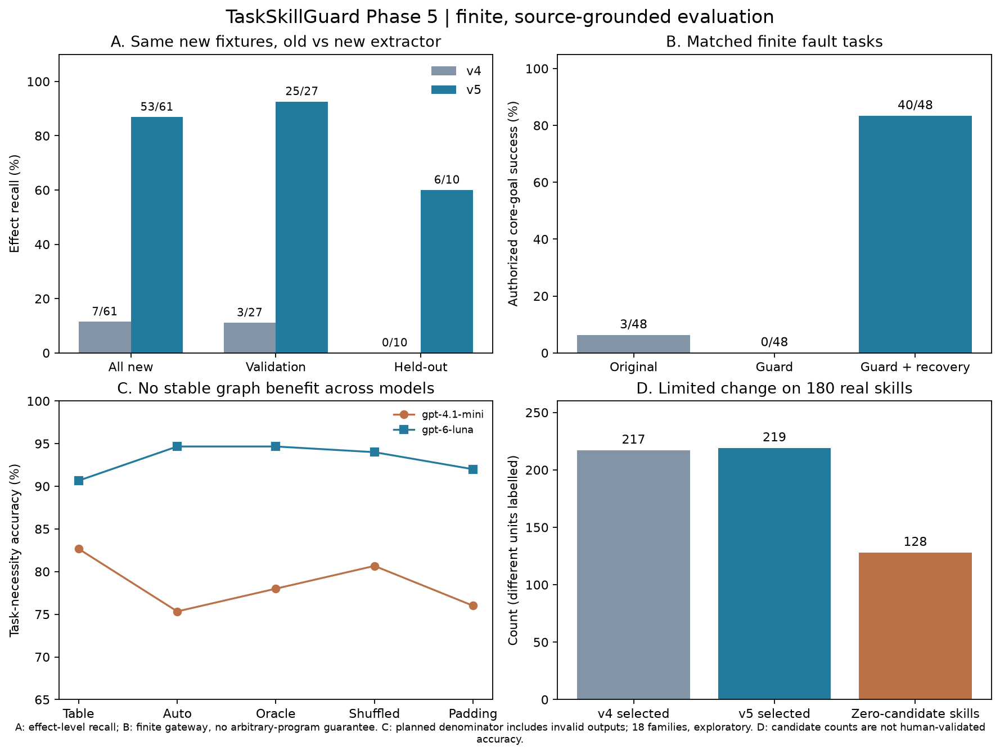

# TaskSkillGuard Phase 5

本轮自动化实验完成；人工标注继续由用户安排。旧基线 20,899 个文件全部保留，历史入口不改。

- [中文完整报告：新家族、unknown、图边与合法恢复](docs/phase5_report.md)
- [机器可读比较](results/phase5/publication_v2/comparison.json)
- [独立请求与缓存用量审计](results/phase5/publication_v2/request_cache_audit.json)
- [费用及剩余预算](results/phase5/publication_v2/budget_summary.json)
- [独立审查](docs/phase5_review.md)、[修订链](docs/phase5_amendments.md)、[复现说明](docs/phase5_reproduction.md)
- [人工标注交接](data/phase5/human_review/README.md)：每名标注员 832 条空白记录；真实语料准确率尚未知。
- [保存证据验证](results/phase5/provenance/release_verification.json)

结果摘要：新家族效果召回 7/61→53/61，首次留出 6/10；真实 180 份 Skill 仅新增两个候选，128 份仍零候选；图边无跨模型稳定增益；隔离故障实验的授权内成功从仅拦截 0/48 提升为合法恢复 40/48。

主采集 588 条件/510 独立请求，单独 q017 澄清补测 30/24，恢复实际 180 次容器。本轮新增费用上界 $0.410898，按授权累计限额仍余 $13.396124。协议错误、请求失败、歧义首答及旧结果均保留。

