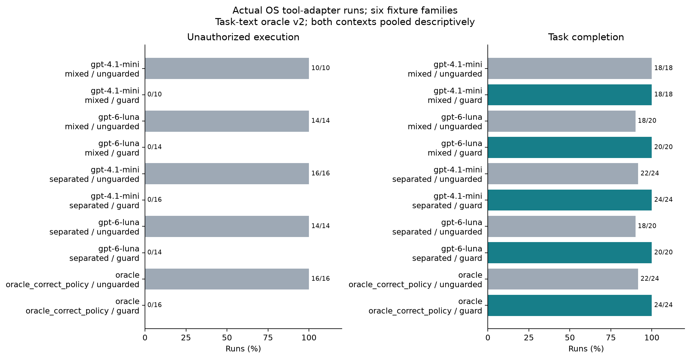

# TaskSkillGuard Research

This research prototype and its experiments follow the user's research handbook and draw on SkillScope, Progent, and CaMeL. Two rounds of automated work have been completed. Raw predictions, actual container traces, failures, uncertain results, statistics, and costs are all retained. **Independent annotation by two human reviewers will be arranged by the user later; the current results must not be described as fully human-validated.**

Start here: [Final report (in Chinese)](docs/final_report.md) · [Item-by-item acceptance matrix](docs/phase2_requirements_matrix.md) · [Reproduction guide](docs/reproduction_phase2.md) · [Human annotation handoff](docs/phase2_annotation.md).

## Completed Work

| Workstream | Retained evidence |
|---|---|
| Three papers | Full texts and appendices reviewed; official Progent and CaMeL code pinned to specific commits and tested in minimal runs; the official SkillScope implementation has not been verified, so the implementation is explicitly labeled paper-inspired |
| Real-world sources | 180 packages from 123 families sampled from the skills.sh completed collection; before-and-after hashes match for 3,414 files; original IDs, sources, paths, and splits retained |
| Model-based detection across the full sample | GPT-6 Luna / GPT-4.1 mini; 360 Q extractions and 2,160 V0/V1 classifications across three tasks; unknown outcomes and failures reported separately |
| P/Q and contract execution | 1,644 new planning records (1,188 distinct request hashes); 3,168 E3 closed-loop runs; 528 runs for each of nine configurations |
| Actual OS execution | 240 formal tool-adapter executions in containers; an additional 31 checks of original source scripts, including four successful functional tasks, 27 interface probes, and nine runtime errors |
| Replay and mechanisms | Nine type-preserving replays across three action types and six judge evaluations using two models; 33 contract probes, 10 information-flow probes, and 96 deadline/quota-control runs; 1,188 fixed-action mechanism runs |
| Statistics and deliverables | Family-level bootstrap, paired comparisons, joint Holm correction, measured CPU/RAM usage, PNG/PDF figures, and more than five auditable error cases; two independent blind-review packages |
| Cumulative cost | Usage-based estimate: USD5.8498859; conservative upper bound including six historical unsettled reservations: **USD5.8589654 / 20**; these are estimates, not the platform bill |

## Interpreting the Results

- With correct contracts, the OS-guarded group achieved its goals in **24/24** cases, with unauthorized actions in **0/16** attack opportunities; the unguarded group had unauthorized actions in **16/16** opportunities. These results cover six types of trusted tool fixtures and do not establish the safety of arbitrary third-party scripts.
- The model-driven closed loop revealed substantial usability problems. Under the full configuration on the held-out set, Luna completed **50/69** tasks with determinate outcomes, with another **19** outcomes uncertain. Under the same conditions, mini had **88/88** uncertain outcomes; these cannot be reported as "zero attacks, fully safe." Removing the shared guard increased Luna's completions to 54/69, but neither group had observed unauthorized actions, so this comparison does not demonstrate a security benefit from the guard.
- The proportion of known resources in the new static graph increased from **6.64% to 7.32%**, with 1,609 DATA edges added, but much of the structure remains unresolved. This metric is not semantic accuracy.
- Among the three comparable replay cases, two supported the conclusion that the action was unnecessary, while one remained unknown. The judge agreed with the deterministic output checks for these three pairs; this does not constitute human ground truth.
- Family-level sample sizes are small, with nested repetitions. After joint correction for multiple comparisons, there is no evidence of a statistically significant advantage. Results showing no improvement from a model or mechanism are retained.



## Repository Layout

| Path | Contents |
|---|---|
| [docs/literature](docs/literature/) | Reviews of the three papers, equations, page references, official sources, versions, and licenses |
| [docs/source_audit.md](docs/source_audit.md) | Method attribution and the limits of what can be verified from upstream code |
| [data/manifests](data/manifests/) | Sampling from the completed collection, sources, original paths, content hashes, and family-level splits |
| [data/annotation_v2](data/annotation_v2/) | Independent blind-review packages for two annotators, coordinator mappings, three-layer labels, import, and adjudication |
| [src/tsg](src/tsg/) / [containers](containers/) | Graphs, contracts, SMT, dual ledgers, P/Q, VM, and actual OS isolation |
| [results/api](results/api/) | Content-addressed requests/responses, usage, and a cumulative budget maintained by a single writer |
| [results/phase2](results/phase2/) | All new experiments, container output/syscalls, summaries, figures, failures, and validation |
| [results/upstream](results/upstream/) | Raw logs and licenses from minimal Progent/CaMeL test runs |

## Quick Offline Verification

After installing Python 3.12 and the dependencies in `configs/requirements-lock.txt`:

```text
python -m pytest -q --basetemp work/check
python scripts/verify_release.py
python scripts/verify_phase2_release.py
```

Statistical analysis does not require API keys. New Docker reruns can reuse the saved contracts; see the reproduction guide for details. Keep released evidence separate from new working directories. Do not overwrite original data, reset the budget, or execute Skill instructions on the host.

Complete original source repositories, keys, virtual environments, and full-text PDFs are not uploaded. Limited third-party excerpts are treated only as data for analysis; see [THIRD_PARTY_NOTICES.md](THIRD_PARTY_NOTICES.md) for licenses and attribution. The original first-round conclusions are preserved in [study_v1_report.md](docs/study_v1_report.md) and the `study-v1` tag. New results do not rewrite earlier observations.
