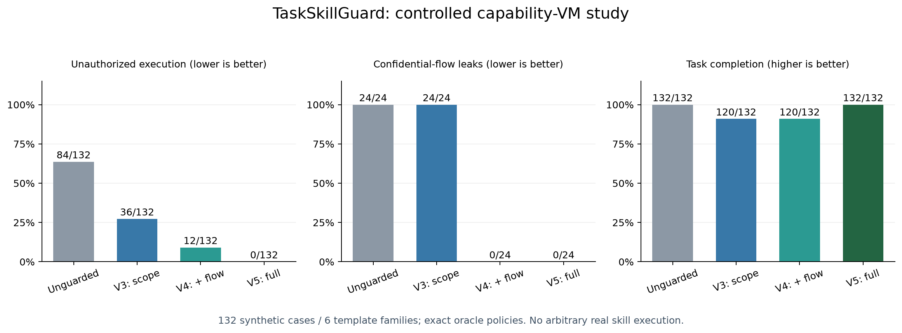

# TaskSkillGuard Research

基于 SkillScope、Progent、CaMeL 的可复现研究原型。按用户研究手册设计、真实调用 GPT-6 Luna / GPT-4.1 mini，保留数据来源、原始预测、执行轨迹、失败与费用。

**先读：[中文研究报告](docs/final_report.md) · [手册要求逐项状态](docs/requirements_matrix.md) · [复现指南](docs/reproduction.md)。**

## 已执行的研究

| 轨道 | 实际证据 |
|---|---|
| 论文与代码 | 三篇全文/附录审计；Progent、CaMeL 官方仓库固定 commit 与本地探针；SkillScope 官方实现未核实到 |
| 真实语料 | 从 skills.sh completed 只读抽180包、123家族；3,414文件哈希复核无变化 |
| 真实模型审计 | 获准的30包×两模型=60提取记录；90个假设任务、360条任务条件化预测；人工标注列留空 |
| 合成实验 | 132案例、6模板；1,056条正式分类、528合同、528计划、72格式变形记录 |
| 动态机制 | 1,188条内存VM运行、396组original/replay/reference、396次策略更新 |
| 补充验证 | 72次LLM Judge；48次开发集单句提示消融；逐家族bootstrap与事后标签敏感性分析 |
| 费用 | usage估算USD1.3559874；含未结算预留的保守上界 **USD1.3650669 / USD20** |

## 主要发现

- 固定合成程序：未守卫84/132案例越权；完整配置0/132，目标达成132/132。V3仍泄露24/24，V4与V5为0/24。**仅适用于有限内存模拟、冻结的精确策略。**
- 合成测试集直接文本V0已接近天花板，增加图没有提高检测，部分条件反而退化。V2/V5后处理没有提升必要性F1。
- 真实静态图约94.65%的候选节点缺少具体资源；模型之间有明显分歧，不能据此报告真实恶意率或安全准确率。
- LLM Judge会混淆原始与中和执行；复核保留这些失败，没有把理由流畅当作正确证据。



## 目录导航

| 路径 | 内容 |
|---|---|
| [docs/literature](docs/literature/) | 三篇全文阅读记录、公式/代码/版本核验、上游复查说明 |
| [docs/source_audit.md](docs/source_audit.md) | 方法归属、官方仓库与独立重写界限 |
| [docs/design_amendments.md](docs/design_amendments.md) | 旧设计问题、冻结前修订、适用范围 |
| [data/manifests](data/manifests/) | completed抽样、原始标识/路径/哈希、家族切分、未修改核验 |
| [data/annotation](data/annotation/) | 双人标注待审核表；没有伪造human GT |
| [src/tsg](src/tsg/) | corpus、partial graph、策略/SMT、信息流、内存VM、模型记录与统计 |
| [results/api](results/api/) | 请求/响应/usage、内容寻址缓存、完整预算账本 |
| [results/summary](results/summary/) | CSV/JSON、覆盖率、置信区间、错误明细、成本对账 |
| [results/supplement_summary](results/supplement_summary/) | 真实迁移一致性、Judge、提示消融 |
| [results/upstream](results/upstream/) | Progent/CaMeL原始探针结果和许可证 |
| [results/verification](results/verification/) | 测试、回链、运行稳定性及交付核验 |

## 离线检查

安装 Python 3.12 与 `configs/requirements-lock.txt` 后，在仓库根目录运行：

```text
python -m pytest -q --basetemp work/local-check
python scripts/verify_release.py
python scripts/check_runtime_stability.py
```

统计重算不需要API密钥。请按[复现指南](docs/reproduction.md)建立 `work/` 副本，运行 `analyze_results.py`、`analyze_supplement.py`、`analyze_combined.py`、`plot_results.py` 和 `write_report.py`，以保留发布证据。

## 必须保留的边界

这不是完整三论文主实验复现，不是OS沙箱，不执行原始Skill脚本；没有真实Skill动态held-out或人工双标注。P/Q只实现组件隔离，运行策略为oracle policy，未形成完整自主agent评测。合成测试集只含2个模板家族，且机制开发时见过这些模板，统计外推很弱。

2笔历史已计费调用缺原始响应，费用仍计入；6笔未结算预留未删除。正式结果均能回链现存raw。旧设计/旧解析结果另存，排除正式分母。

原始整库、密钥、虚拟环境和PDF全文不上传。第三方片段只作为研究数据，不可当安装或执行指令；原版权与许可证见 [THIRD_PARTY_NOTICES.md](THIRD_PARTY_NOTICES.md)。
