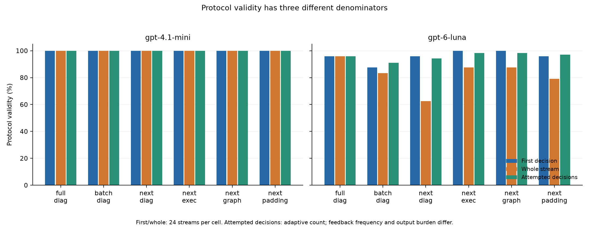
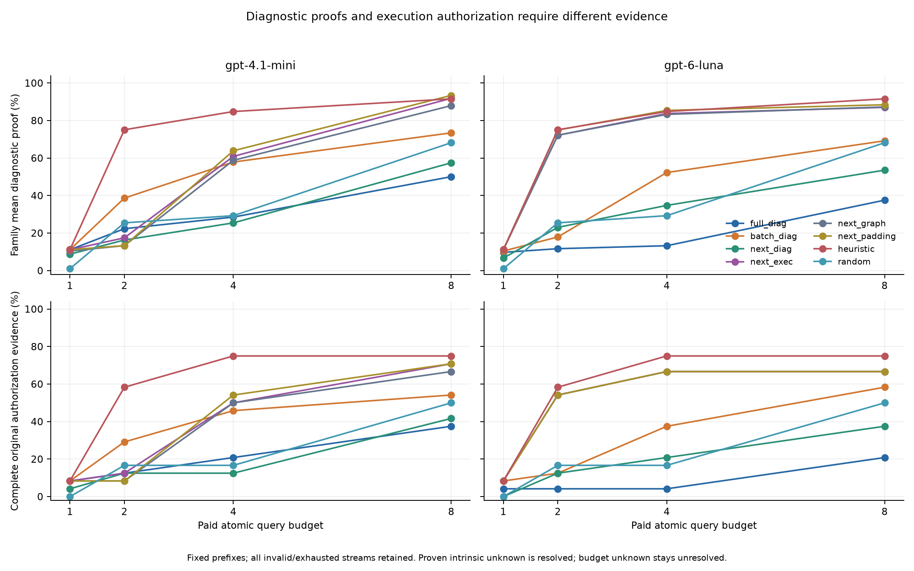
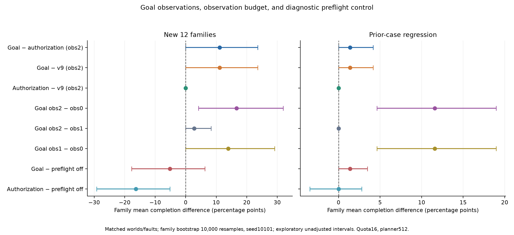
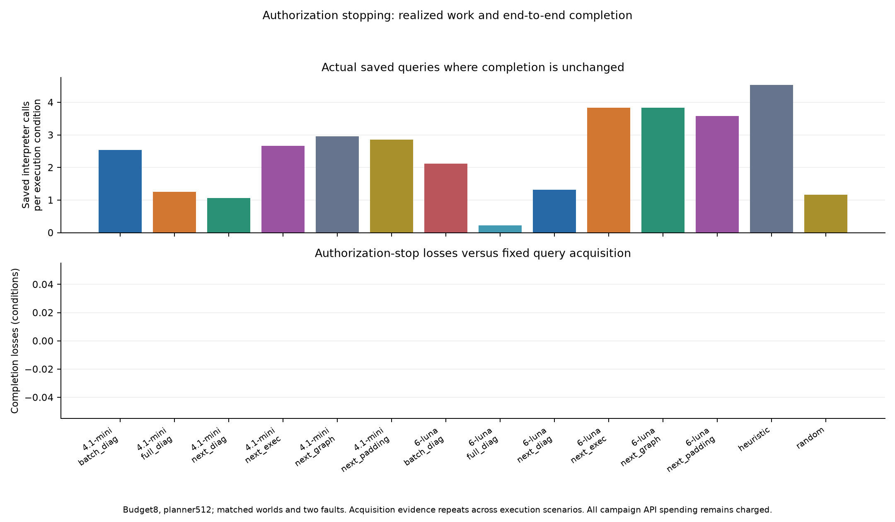
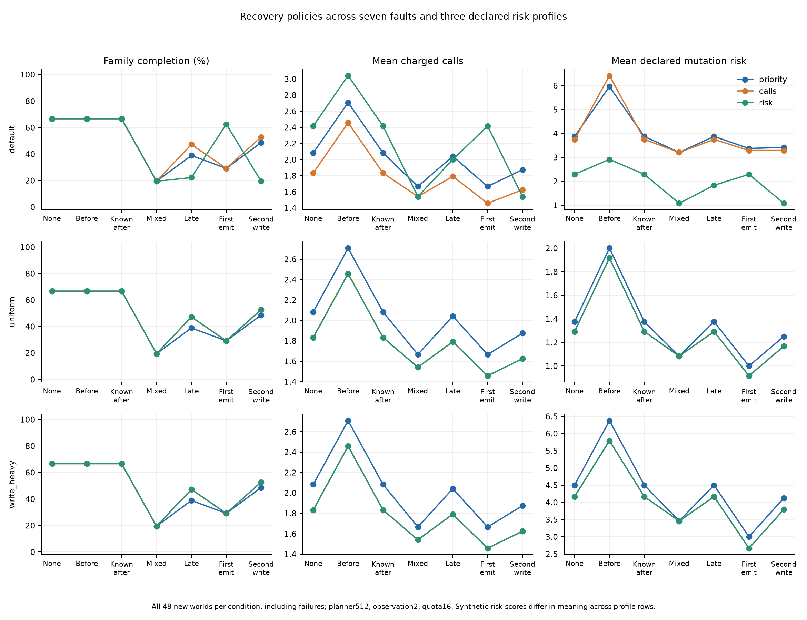

# Phase 10：与决策相关的观测、增量查询和实际停止

本轮直接执行合成研究。独立作者的生成器和参考首稿事先生成并隔离，不向生产作者暴露；生产控制器与方案冻结后，首稿原样交付并实体化，再冻结数据。新集包含24个任务、12个家族、48个世界、140个候选副作用点，每个家族两个任务变体。旧Phase7/8/9的96个任务、168个世界、438个候选点只作回归。新集没有真实Skill、人工标注或模型输出驱动的数据修订。

主要问题是：授权证据充分后，是否仍缺少决定目标可行性的观测；增量查询能否改善协议与证据；真正停止解释器能否减少工作而维持完成；风险策略是否稳健优于调用数策略。正向结果不是研究成功的前提。

## 观测解决了部分保守拒绝，也留下了失败

下表每行均包含新集48世界×4故障＝192个条件，quota16、规划预算512、calls策略。完成数和工作总数是描述性条件统计，不能把192当作独立样本。

| 控制器 | 观测预算 | 完成条件 | 真实调用 | 规划单位 | 目标观测 |
|---|---:|---:|---:|---:|---:|
| v9 | 2 | 96/192 | 288 | 8,128 | 0 |
| v10授权观测 | 2 | 96/192 | 288 | 8,128 | 0 |
| v10目标观测 | 0 | 80/192 | 212 | 8,648 | 0 |
| v10目标观测 | 1 | 112/192 | 396 | 8,264 | 56 |
| v10目标观测 | 2 | 120/192 | 442 | 8,344 | 72 |
| 关闭预检诊断控制 | 2 | 130/192 | 818 | 5,616 | 0 |

在完全相同的预算2下，目标观测相对授权观测有24胜0负。主估计为**家族均权＋11.11个百分点，95%区间[0.00,23.61]**；条件微平均则为24/192＝12.50个百分点。这两个数字的分母不同：optional_overwrite_fork和transform_pipeline各为8胜/16条件，two_gate_relay为8胜/24条件，另外九个家族均为零。因此主估计是(1/2＋1/2＋1/3)/12，而非把世界更多的家族赋予更高权重。

目标观测预算2相对预算0为＋16.67个百分点[4.17,31.94]；预算2相对1为＋2.78个百分点[0.00,8.33]。收益集中于少数家族，预算2仍有72/192个条件无法完成，失败原因均为no_feasible_route。不能由此宣称两次观测足以解决全部不确定性。

关闭预检仍是诊断控制：目标观测相对它有6胜16负，家族差值−5.21个百分点[−17.71,6.25]。关闭预检完成更多，但真实调用818次，而目标观测为442次，且存在相反方向的个别胜负；它不能被当成同一个信息机制的单因素替代。

固定历史回归子集中的16个nested_noop_observer损失全部恢复：v9和授权观测均0/16完成，目标观测16/16，关闭预检16/16。该子集来自未改动的Phase9成对结果，其16个条件不能再作为新的16个独立任务。

## 查询和停止的计量边界

六个采集单元为完整排列/诊断、小批量/诊断、下一条/诊断、下一条/执行、下一条/执行/图、下一条/执行/惰性字符填充；两模型、每格24个新任务。完整排列最多一次模型请求，增量单元最多八次决策，不自动重试，不用真值修复错误，也不替换无效输出。

首决策有效性、完整流有效性和每次尝试有效性分别报告。后者的分母由自适应流长决定；协议比较同时改变反馈频率和输出负担，不能将差异全归于JSON模式复杂度。图必须同时与源文本和惰性填充比较；字符长度匹配不等于token匹配。

全部288条流均已收到；1,587次决策中1,562次有效，263条流完整有效。Mini六格的首决策和完整流均为24/24，但不是简化协议带来的新增有效性，因为完整排列也已经全有效。Luna如下：

| Luna单元 | 首决策有效/24 | 整流有效/24 | 有效决策/尝试 |
|---|---:|---:|---:|
| full_diag | 23 | 23 | 23/24 |
| batch_diag | 21 | 20 | 41/45 |
| next_diag | 23 | 15 | 149/158 |
| next_exec | 24 | 21 | 171/174 |
| next_graph | 24 | 21 | 171/174 |
| next_padding | 23 | 19 | 165/170 |

这不支持“协议越短，整流越可靠”的简单结论。25次失败均为Luna，分层为11次API错误、1次incomplete、13次已完成响应的MULTIPLE_OUTPUT_TEXT响应信封失效；没有本地选择ID或cardinality验证失效。11次API错误的服务端记录为HTTP400、invalid_request_error/invalid_prompt；不将它们或多文本信封失效写成选择schema本身的错误，也不猜测服务端触发原因。19条无效流仍保留失效前已购买的有效前缀。每条失败及费用上界均保留，无自动重试。

固定预算8时，各单元的无条件覆盖如下。证明总分母为140候选点×3轴＝420；家族覆盖先求每任务的证明比例再对12个家族均权。完整原始授权证据的分母则是24任务，不能把它与140个授权标签证明混用。

| 查询策略 | 家族诊断覆盖 | 已证明/420 | intrinsic unknown | budget unknown | 完整授权证据/24 | 解释器调用 | 进入步骤 |
|---|---:|---:|---:|---:|---:|---:|---:|
| Mini full_diag | 50.07% | 203 | 88 | 217 | 9 | 192 | 1,516 |
| Mini batch_diag | 73.45% | 303 | 137 | 117 | 13 | 192 | 1,479 |
| Mini next_diag | 57.47% | 240 | 110 | 180 | 10 | 192 | 1,488 |
| Mini next_exec | 91.85% | 382 | 182 | 38 | 17 | 192 | 1,448 |
| Mini next_graph | 87.96% | 362 | 170 | 58 | 16 | 192 | 1,446 |
| Mini next_padding | 93.43% | 392 | 189 | 28 | 17 | 192 | 1,460 |
| Luna full_diag | 37.57% | 147 | 69 | 273 | 5 | 184 | 1,427 |
| Luna batch_diag | 69.21% | 290 | 131 | 130 | 14 | 164 | 1,295 |
| Luna next_diag | 53.56% | 223 | 108 | 197 | 9 | 149 | 1,159 |
| Luna next_exec | 87.04% | 364 | 178 | 56 | 16 | 171 | 1,237 |
| Luna next_graph | 87.27% | 362 | 176 | 58 | 16 | 171 | 1,261 |
| Luna next_padding | 88.43% | 370 | 186 | 50 | 16 | 165 | 1,237 |
| 固定启发式 | 91.57% | 384 | 192 | 36 | 18 | 192 | 1,558 |
| seed10101随机 | 68.19% | 285 | 143 | 135 | 12 | 192 | 1,484 |

执行目标比诊断目标提供更多诊断证据，但模型策略并未由此稳健超越冻结启发式。图相对源文本及字符填充均没有一致优势。较少解释器调用也可能来自失效后流中断；不能把Luna较小的执行总数直接叫作效率收益。

同为next协议，执行目标相对诊断目标的家族覆盖差为Mini＋34.38个百分点[7.87,61.28]、Luna＋33.47[8.01,59.31]。图相对源文本为Mini−3.89[−12.96,1.39]、Luna＋0.23[−12.27,12.73]；图相对字符填充为Mini−5.46[−18.06,6.20]、Luna−1.16[−12.96,9.95]。区间均为探索性家族bootstrap；图的两个比较均不支持稳定正向收益。

诊断完成与原始执行授权证据完成是两个目标。已证明的intrinsic unknown算作诊断解决；因预算尚不能证明的unknown保持未解决。所有已声称证明的标签均与独立真值逐项核对。预算1/2/4/8、fixed/diagnostic/authorization停止均保留无效和耗尽条件。

实际前缀回放会停止解释器调用。集成实验比较同一已采集流的固定前缀与授权停止，查询预算2/8、规划预算128/512、两种故障。只在配对条件端到端完成状态相同时计算“保持完成的查询节省”，另列两边均成功的条件；完成损失必须单独列出。提供查询证据的运行时不允许暗中再审计原始程序。

按每个case/pipeline/budget仅计一次，预算2和8共有672组固定/授权停止回放比较，其中195组减少了查询。预算2的336组counter差合计19次调用、107步；预算8的336组差合计832次调用、7,010步。数据保存在[唯一前缀比较](../results/phase10/analysis/unique_query_stopping.json)。例如heuristic在p10-transform_pipeline-0、预算8时，从8次查询降至2次，实际前缀回放少进入6次调用、42步。这里比较的是两条实际回放记录，不能写成本轮采集活动从未执行过这些后缀。

集成展开为5,376组fixed/authorization配对；两边整个运行时result字典完全相同，故完成无胜无负，真实调用和规划工作也不变。1,508组部署情景减少查询，其中796组两边均成功。所有世界、故障及规划预算展开后的counter差为6,596次查询、53,980步，**这是重复部署情景的工作量差，不是本轮采集在物理上少执行6,596次**。预算8时，跨查询策略的家族均权每执行条件节省2.48次解释器调用[1.51,3.43]，两个规划预算下相同；预算2仅节省0.057次[0,0.170]，收益集中于一个家族。

授权标签证明与停止所需的完整执行证据也有区别：预算8启发式证明140/140个授权标签，但仅18/24任务拥有本停止契约要求的完整原始世界执行证据。原始运行不完整时，授权标签可以已经有证明，停止谓词仍不会假称证据完备。停止契约是充分条件，没有声称全局最优。

最终完成并没有随查询诊断覆盖同步上升。以下固定为查询预算8、规划512、无故障、authorization停止，每行48个世界。工作数字为该48世界的部署情景总数，查询与规划不能加成总CPU。

| 查询策略 | 最终完成/48 | 家族完成率 | 查询解释器调用 | 规划单位 | 真实调用 |
|---|---:|---:|---:|---:|---:|
| Mini next_exec | 30 | 66.67% | 256 | 880 | 88 |
| Mini next_graph | 30 | 66.67% | 242 | 855 | 88 |
| Mini next_padding | 29 | 65.28% | 247 | 875 | 83 |
| Luna next_exec | 29 | 65.28% | 158 | 828 | 83 |
| Luna next_graph | 29 | 65.28% | 158 | 847 | 83 |
| Luna next_padding | 29 | 65.28% | 159 | 867 | 83 |
| 冻结启发式 | 30 | 66.67% | 166 | 902 | 88 |
| seed10101随机 | 28 | 63.89% | 328 | 660 | 78 |

Mini执行目标和图均未超过启发式的最终完成，查询调用反而更多，且还需要模型请求；部分规划计量较低，仍须分别看待这些维度。Luna较少查询伴随流失效和较低完成，不能称为保持完成的效率改善。同样设置改为查询预算2，上表八种策略全部28/48完成、家族完成率63.89%，查询调用依次94/94/94/89/89/90/94/96。更高诊断覆盖没有在这个低预算切片转化为额外最终成功。

## 恢复策略不是单调优胜

新集恢复网格为48世界×7故障×3风险权重×3策略＝3,024条件。七种故障包括位置故障及first_emit_ambiguous、second_write_ambiguous操作序号故障；目标操作从未到达的条件仍保留。风险权重分别为默认read0/write1/delete2/emit8、统一变更1，以及write-heavy的read0/write4/delete4/emit1。

默认权重下，risk相对calls有14胜24负，家族均权完成差−3.57个百分点[−7.14,0.00]；统一权重和write-heavy权重下完成差均为零。calls相对priority每种权重均有6胜0负，家族差＋1.79个百分点[0.00,4.76]。风险评分更低不能自动推出完成、调用数和风险的Pareto支配；所有失败均计入，双成功条件下的工作差另外报告。不同权重行的风险分数含义不同，不作跨权重数值排序。

默认权重下的故障交叉尤其清楚：first_emit_ambiguous中risk相对calls有14胜0负；late_ambiguous为0胜10负；second_write_ambiguous为0胜14负。即使固定同一权重，位置故障和按操作触发故障也改变收益方向；不能将其中一个有利故障外推到其他故障。

## 验证、统计与可复查材料

全部120任务共216世界、578候选点，独立参考与生产解释器的1,944项执行/抑制比较一致。接口5,184、恢复3,024、集成10,752，共18,960执行条件在78个隔离容器中重放且与本地逐项一致；没有越权副作用、重复副作用或超调用配额。集成运行的隐含审计调用和审计步数均为零。4,032条查询条件中所有已证明标签均与独立真值一致。

主区间使用家族内配对差值均值，再对家族均权bootstrap10,000次，seed10101；新旧分开，区间探索性且未作多重比较校正。世界、故障、预算和同一响应的不同前缀均有依赖，不构成新的独立样本。

分析器只读取已保存证据，不调用模型、生成器、求解器或运行时。独立手算玩具测试覆盖家族均权、bootstrap等价性、无效流与未知费用、证明边界、缺失配对、实际停止的完成损失、暗中审计、Pareto权衡和历史子集键。分析表、原始引用、统计方法及失败条件保存在results/phase10/analysis；静态PNG/PDF及绘图源数值保存在results/phase10/figures。

全量验证记录为1,305 passed、4 skipped、150 subtests，保存于results/phase10/validation/tests.xml；当次收集包含9个分析测试。后续focused验证最终11/11通过，另含bootstrap等价性和唯一前缀分母控制，保存于results/phase10/validation/analysis_tests_final.xml；中间10项focused结果也原样保留。后续控制没有被追溯描述为早先全量验证的一部分。分析完整重算和五组PNG/PDF重绘均通过不可变字节比较，五张图已逐张视觉检查布局、刻度和图注。

本轮实际采集的保守费用上界增量为**$1.504516700**，累计**$18.887809250**，剩余**$10.663765875**，均未触及本轮$6增量上限或累计$29.551575125上限。11条未知用量决策保留预留上界，未当成零费用；继承的历史未决预留继续保留。这是本地保守核算，不是提供商账单。

查询解释器调用与步数、目标观测、规划单位与步数、模型请求和真实网关调用分别核算，不能合并成总CPU。所有采集支出始终保留，包括较早停止的部署情景不再需要的后续决策和未知用量预留。前缀归因费用不是本轮账单节省。以上结论仅限有限合成程序及指定控制器，不证明真实Skill安全、一般注入防御、全局最优停止或风险策略普遍有效。

## 下一轮可证伪的方向

后续可以单独检验多文本响应信封的协议兼容性、API拒绝与模型输出的分层计量，以及包含模型请求的自适应部署成本。应先定义和冻结新的信封接受规则及测试，再在独立新任务上比较；本轮不事后补答、重试或放宽parser。仍应保留启发式、字符填充、低预算及不可区分世界，防止把信息不足、流可靠性或故障目标未被触发误写成模型推理收益。

