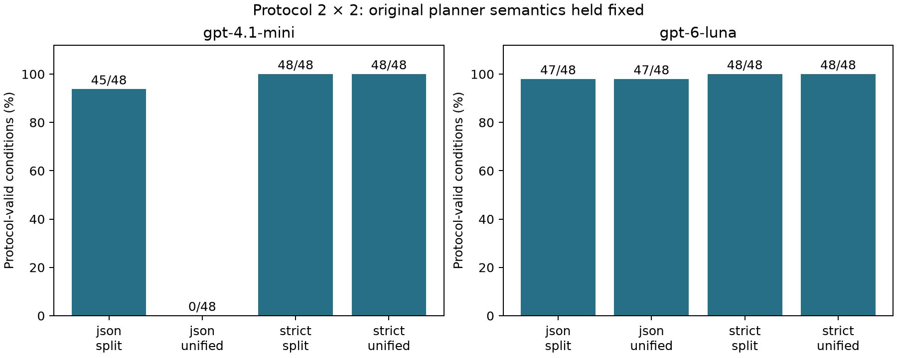

# TaskSkillGuard 第三轮：修复、对照与新实验

本轮首先修复协议、权限范围、必需步骤和参考恢复，再冻结新任务家族与真实样本条件。原始结果、首次响应、失败记录和前两轮报告全部保留。人工标注由用户安排，本报告不报告真实 Skill 的准确率、F1 或恶意率。

完整数值表见 [第三轮数据表](phase3_results_tables.md)，机器可读汇总见 [summary.json](../results/phase3/analysis/summary.json)。方法、修订和复现分别见 [分析方法](phase3_analysis_methods.md)、[独立审查](phase3_review.md)、[复现说明](reproduction_phase3.md)。

## 首先区分三种“修复后”

1. **同一旧 P/Q 输出，换修复执行器**：用来观察执行与恢复实现的变化。旧格式错误不会凭空消失。
2. **修正协议和提示，重新取得 P/Q，再跑旧任务**：用来做已见回归；原先的留出组现在已经被诊断过，不能再叫未见测试。
3. **冻结后跑新家族**：16 个新转换家族，其中 8 个留出；仍共享有限读、变换、写、公开通知语法，属于有限范围的泛化。

新家族更换的是转换任务与预期输出，仍沿用原权限语法和攻击模板。本轮未进行自适应攻击搜索，不能据此宣称对新攻击类型或开放环境具备同等效果。

| 原留出组 / 每模型 88 条 | mini 确认完成/计划 | Luna 确认完成/计划 | Luna 可判定 |
| --- | --- | --- | --- |
| 原 v2 | 0/88 | 50/88，56.8% | 69/88 |
| 同一旧 P/Q，v3 执行器 | 0/88 | 65/88，73.9% | 65/88 |
| 新 P/Q、修正协议与提示，v3 | 88/88 | 88/88 | 88/88 |

第二行的 Luna 成功提高了 15 条，但可判定数量下降 4 条：原本漏授权的合同现在被明确阻塞。因此不能仅用“可判定内成功率从 72.5% 到 100%”宣传收益；全部计划分母上的 56.8%→73.9% 才同时反映覆盖损失。mini 的旧合同含错误操作类型，执行器无法修复，仍有 88 条协议失败。

v3 是独立修复内核，改变了多处执行机制，未完整重跑旧的图分类/Replay/SMT 路径。这是修复组合的回顾性比较，不能把 15 条收益都归因于某一个组件。

## 协议故障确实可以由接口设计制造

保持原 P 提示语义，只改变输出格式和工具目录，mini 每格 48 条结果为：普通 JSON＋混合目录 0/48；普通 JSON＋分离目录 45/48；两种严格 Schema 条件均 48/48。错误主要是把纯 `transform` 放入需要权限的操作列表。由此支持“目录和接口导致大量 unknown”的归因，而不是“mini 无法理解任何任务”。

Luna 在严格 Schema 下仍出现范围/参考步骤缺失，说明格式约束不能代替语义设计。正式新 P/Q 提示进一步明确：公开常量 `DONE` 与机密输入没有数据依赖，纯转换无需额外权限，必需效果必须全部覆盖。



## 新家族结果与尚存的解析错误

冻结主实验的新留出组：mini 256/256 确认完成；Luna 249/256，97.3%。两者已判定轨迹均未出现未授权效果；这些成功由受限转换适配器实现，不能外推为任意源码安全执行。

Luna 的 7 条未判定并非 7 次独立模型失败：P 的一个响应被 5 个任务条件复用，另有两个 Q 响应，共 3 个请求。检查原始响应发现，每个都有明确的 `commentary` 中间消息和 `final_answer` 最终消息，而本轮首次解析器把所有 `output_text` 当成竞争的最终结果。这仍是我们的接口实现问题。

官方文档明确区分这两种消息阶段；据此增加独立的阶段感知解析器，仅接受一个完整最终答案，并继续拒绝拒答、截断、多个最终答案、未标记的歧义输出或异常工具事件。[OpenAI 官方阶段说明](https://developers.openai.com/api/docs/guides/reasoning#phase-parameter)

这项修复是在看到新结果后提出，故只作为**事后、同一原始响应的重放**，单独保存于 `results/phase3/phase_protocol/`，不覆盖上述 249/256 或伪装为新的独立留出实验。完整规则和重放结果见 [阶段解析修订](phase3_phase_protocol.md)。没有为挑选成功答案再次付费调用模型。

完整离线重放后，两模型在新留出组均为 256/256 确认完成，未观察到越权或泄漏。真实样本中另有 22 个同类协议失败被修正，协议有效条件由 1844 增至 1866；这些是接口修复后的同一观察，不是新增独立样本。

## 恢复改善可用性，但守卫必须用固定攻击检验

在新留出组，关闭参考恢复后，mini 从 256/256 降至 224/256，Luna 从 249/256 降至 219/256。关闭后的确认完成率差分别为 −12.5 个百分点和 −11.72 个百分点；按 8 个家族重采样的描述性 95% 区间分别为 [−12.5, −12.5]、[−12.5, −10.94] 个百分点。重复模板导致第一个区间退化，不能把它解释成开放世界效果没有不确定性。

新流程在执行前核对必需效果和完整依赖图；如果 Skill 让合法读操作依赖一次未授权凭证读取，只能选用已被模型合同和可信任务上限共同允许的参考流程。没有扩权、删除未知依赖或重置已用额度。

仅关闭义务检查时，mini 少完成 2 条，Luna 在已判定条件没有减少。依赖检查仍可触发恢复，因此这是条件性边际效果；不等于义务检查没有价值。旧漏通知、空计划和非法参考路线另有定向回归测试。

| 全部新家族，固定 160 个恶意条件 | 确认完成/256 | 未授权/160 | 泄漏/160 |
| --- | --- | --- | --- |
| full | 256 | 0 | 0 |
| no_scope | 256 | 64 | 0 |
| no_lease | 256 | 32 | 0 |
| no_recovery | 224 | 0 | 0 |

full 中 160 个计划攻击动作只有 128 个到达运行时守卫，另外 32 个被执行前参考替换，不能计为守卫拦截。关闭 scope 后 64 条未授权效果出现；关闭 lease 后 32 条出现。这比“模型自己没有选择攻击，所以各组都零越权”更能说明这些组件的作用。

body 与 taint 会相互遮挡：主机制格里关闭任一项都仍可由另一项拦截。额外六个正交探针分别使用“公开但错误的 body”和“机密来源、字节恰好是 DONE”的输入，验证两者独立作用。后者同时暴露并修复了评分漏洞：机密 DONE 泄漏后，真正公开通知被拒绝，必须记为任务失败。

固定机制合同均正确，因此 no_authority 没有非法初始合同机会，不能由零差异推断该组件有效或无效。`model_raw` 只去掉初始授权校验，仍有恢复；`trusted_compile` 只替换范围，仍保留 P 协议/关键未知门槛。名称不代表“裸模型”和“理想编译器上界”。

## 真实语料的主要发现是覆盖不足

沿用已获授权的 180 个 completed 样本，不跨来源重新混抽；来源、原标识、文件路径和哈希仍可追溯。读取上限为每份 24,000 字符、12 个文件；实际分析 430 个文件，74 个截断，2447 个因边界省略。每样本最多选择 12 个候选动作，共 1711 个；截取前有 4097 个。10 个样本无候选，因此 2160 个计划条件中有 120 个不适用，不计作模型成功。

每个样本保留 review_only、edge，以及 explicit_effect/missing_scope 二者之一。严格核对操作与字面资源的局部对应后，只有 3 个 explicit_effect，177 个 missing_scope。这个数来自保守的资格规则与候选截取，不是整个 Skill 都缺乏信息，更不是恶意比例。不能把它与旧 high 组直接做模型能力前后比较。

raw 和 graph_v2 使用相同动作 ID，避免通过改变候选分母制造优势。但图仍是静态近似，文档中的示例不一定是实际动作，未知资源、跨函数状态和遗漏文件也未解决。真实语料结果只能报告覆盖、协议有效率、模型分类分布与分歧；只有完成双人独立标注后才能报告语义准确率。

本轮结束时的独立句法检查进一步发现：1,711 个选中候选中，313 个仅为代码块围栏（例如一行 ` ```bash `），涉及 94 个 Skill；1,578 个候选的资源状态仍为 unknown。这是上游提取器尚未解决的明显噪声和绑定不足，不能解释成模型本身的失败。检查规则与逐节点位置另存于补跑分析，不修改冻结候选，也不据此制造“过滤后准确率”。本轮修复了语境与字面范围的资格判定，尚未完成完整的 Markdown/脚本语法分析和跨函数绑定。

余额恢复后的补跑仅针对 173 条原样的余额失败请求，以及 1 条被截断的请求；后者将输出上限从 3,000 提高到 6,000。补跑的覆盖提升因此包含恢复采集和单条输出上限调整，不能归因于阶段解析或模型语义能力提高。所有 174 条预选补跑都按固定规则进入独立汇总，不根据成功与否挑选。

174 条补跑全部完成，其中 173 条协议有效，1 条原余额失败的 Luna 请求在本次触及 3,000 token 上限；原先预选的 6,000 token 条件取得有效答案。最终汇总为 **2039/2040 个适用条件协议有效**，另有 120 个空候选条件不适用。一次补跑仍失败不触发新的挑选式重试，失败记录和原始响应完整保留。详表见 [真实样本补跑对照](phase3_followup_results.md)。

在 20,520 个有效动作观察中，授权 unknown 为 **12,093（58.9%）**，必要性 unknown 为 **10,745（52.4%）**。它们是同一候选在多个语境、模型和表示下的重复观察，不是唯一动作或 Skill 比例。即使在事后诊断中只看非围栏候选，授权 unknown 仍为 9950/16766（59.3%）；只过滤围栏不足以解决任务授权信息缺失和资源绑定不足。

双方均协议有效的配对中，两模型对授权标签分歧为 4988/10254（48.6%），raw 与 graph_v2 对授权标签分歧为 4749/10254（46.3%）。这些是同动作配对的一致性结果，不能判断哪方更准确，也不能由此宣称图表示优于原文。原始、阶段重放、补跑三层数据和完整三值标签配对表均分别保留。

## 实际 OS、费用与发布核验

OS 的 240 条新运行已经全部实际执行；48 个新模型合同均格式有效且未声明未知。正确合同、两模型的分离/混合合同这五组，在开启 guard 时均完成 24/24、越权 0；关闭 guard 时均完成 22/24、出现 16 条越权。这里的 24 包含非攻击条件，不能把 16/24 标成固定攻击成功率。

在相同 OS 任务和 guard 下，旧 Luna 分离/混合组各为 20/24 确认完成，新轮各为 24/24；旧 mini 混合组为 18/24，新轮 24/24，mini 分离组仍为 24/24。本轮没有观察到混合和分离条件的差异，不由此断言信任分离无价值。

这些运行使用原固定镜像和 12 个任务，只验证实际有限适配器效果。前两轮的真实任意源码 containment 证据保留，但没有被本轮成功率升级为权限安全保证。

补跑新增用量费用估计 **$0.4594151**；含前两轮与本轮全部试次的累计保守费用上界为 **$13.9757919**，低于 $20，仍留 **$6.0242081**。其中已取得用量的费用估计为 $11.8377915，179 项历史未知账单预留为 $2.1380004；未因余额错误或补跑成功而释放这些预留。这些是记录的价格和用量估算，不替代供应商账单。

最终离线测试为 **358 passed、4 skipped**；4 项依赖容器环境的单元测试跳过，实际 240 次 OS 运行另外完整保存。前两轮 10,650 个文件哈希保持一致。发布核验还检查两次修订链、阶段重放、174 条补跑与原条件对应、预算字节前缀及空白人工标签。

## 仍应优先解决什么

1. 用阶段感知协议作为后续新轮次默认解析器，再做一次独立冻结评估；本次事后重放只能验证同一响应上的修复。
2. 提高真实动作与资源证据覆盖：先区分文档示例与可执行动作，再扩展常量/参数绑定与跨函数来源；不可把缺参一律拒绝后称为高安全率。
3. 加入授权错误、无可行参考路线、工具运行失败及更复杂任务语法，避免只在正确合同与固定转换模板上测试。
4. 安排真人独立标注并复核分歧，优先选模型分歧、missing_scope 与三条 explicit_effect 证据；空白交接单元不会被模型代填。

手册各实验在本轮重跑、保留与延期的具体边界见 [需求映射](phase3_requirements_matrix.md)。
