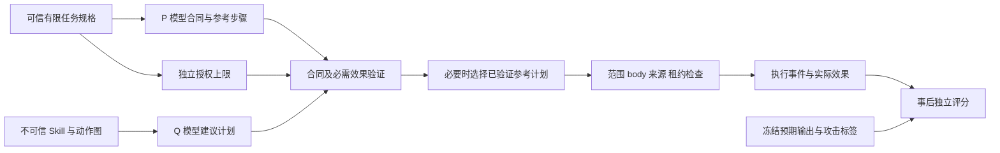

# 修复顺序、手册映射与剩余工作

第三轮是有针对性的修复与新实验，前两轮证据继续保留。没有把每个旧轨道都重新运行，也没有把人工标签填成模型输出。

| 顺序 / 问题 | 本轮处理与证据 | 手册关联 / 尚未覆盖 |
| --- | --- | --- |
| 1. 协议与工具目录混淆 | JSON/strict × unified/split 的 384 条冻结对照；P/Q 分开诊断；保留原始响应 | E0、E3、E9；后发现的 phase 解析问题另作事后同响应重放 |
| 2. 初始授权错误 | 模型合同与可信任务上限对照，缺失/过宽阻塞；raw-scope 与 compiled-scope 分轨 | E5；新主任务中的错误初始范围很少，不能由无差异证明验证器安全收益 |
| 3. 漏必需步骤与人工依赖 | 义务检查、完整生产者证据、执行前受验证参考恢复；禁止扩权和额度重置 | E3、E6；v3 是独立修复内核，未复用旧图分类/Replay/SMT 全路径 |
| 4. 守卫与可用性因果归因 | 固定 160 个恶意任务条件，各变体的计划/到达/执行分别计数；6 个 body/taint 正交探针 | E4、E7；探针是机制反例，不是自然攻击发生率 |
| 5. 真实样本语境 | 原 180 个 completed 样本；raw/graph 同节点；review、edge、explicit/missing 分开 | E1；有界静态图仍含313个代码围栏候选及1578个资源unknown，完整语法提取未解决；未执行这180个Skill，语义精度待真人 |
| 6. 未见家族与实际系统 | 16 个新增转换家族，8 个留出家族；新模型合同下 240 条实际 OS 适配器运行 | E9、E3；有限语法与原 OS 家族，不能声称开放世界泛化 |
| 成本与复现 | 历史账本完整前缀、累计 20 美元硬上限、冻结/修订/原始响应/网格/发布清单 | 费用为用量估算及未知项预留，未替代供应商账单 |
| 人工标注 | 保留原两份独立包，增加 5,133 条新语境交接，标签全部空白 | §12.4；两名真人及第三人分歧复核，由用户安排 |

保留而未在本轮重做的旧轨道包括：31 个真实源码入口的 containment/兼容性试跑、完整旧 Replay/三角必要性、SMT 与合同迁移、旧生命周期与格式变形、Judge 对照。其结论与局限沿用第二轮报告，不因第三轮 VM 成功而自动升级。

最初设计提到了校正与未校正统计。采集前执行记录将本轮统计限定为预定对照的描述性家族 bootstrap，不做 p 值或显著性结论；因此没有额外多重检验校正结果。这个分析选择及其时间点保留在 `phase3_progress.md`，不能将边际区间称为同时置信区间。

## 实现与评分隔离

评分真值不参与授权或恢复选择。`model_raw` 仍使用义务检查与恢复；`trusted_compile` 仍保留 P 的协议/未知门槛和参考路线，二者都不是“完全无辅助模型”或“理想确定性系统”的上界。
