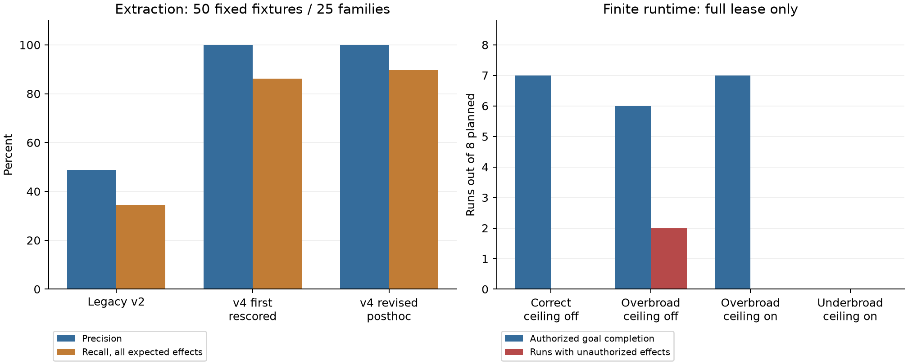

# 第四轮：先修正研究对象，再检验图、必要性与执行限制

本轮确认了旧候选中的结构性误提取和来源接口缺陷；但修复这些问题后，图边仍没有显示出一致的增益，静态提取的覆盖也远不足以支持“真实 Skill 已被完整审计”。本轮没有把旧 unknown 逐项归因，不能给出由某种原因造成的准确比例。独立授权上限在故意过宽的合同下有明确作用，而过窄合同、无可用参考路线和耗尽的额度仍会损害可用性。

本报告区分有独立有限真值的合成实验、没有真人真值的真实语料描述，以及实际隔离运行。所有旧结果保留；没有把失败删除、把 abstention 改成安全，或用模型意见填人工标签。

## 1. 本轮到底完成了什么

| 轨道 | 实际规模 | 可以回答的问题 |
| --- | --- | --- |
| 提取器 | 50 个固定样例，25 个构造家族，58 个预期效果 | 指定语法中的非动作误报、漏检、目标绑定与正确保留未知 |
| 真实语料 | 原 180 个 completed 样本，同一批有界脱敏源码 | 候选结构、覆盖缺口、选择遗漏；不能回答准确率或恶意率 |
| 有限任务推理 | 24 个样例、8 个家族、75 个候选，3 种表示×2 模型，共 144 次请求 | 在明确给定任务规格下区分动作、授权、实现必要性和任务必要性 |
| 真实候选推理 | 18 个有候选的样本×2 个假设任务×3 表示×2 模型，共 216 次请求 | 相同候选下的标签分布、一致性与 unknown 来源 |
| 零候选补充发现 | 固定 12 个样本×2 模型，24 次首轮请求 | 模型能否提供可追溯来源的待人工审查建议 |
| Replay 与合同故障 | 174 条计划条件，173 个实际容器，1 条故意缺失的参考路线 | 中和与参考的有效性、过宽/过窄合同、来源标签和额度影响 |

384 次主采集首答均已记录：378 次 API 完成、4 次 HTTP 520 错误、2 次截断；361 次通过本轨道完整校验。合成推理 144/144 有效，真实推理 212/216 有效，补充发现 5/24 有效且这五份均为空。失败留在计划分母内；没有根据成功结果替换主实验首答。

补充发现的来源协议随后作了一轮明确标记为事后修复的匹配验证，见 [补充协议设计](phase4_discovery_followup_design.md) 和独立结果目录 `results/phase4_discovery_followup/`。它不覆盖上述首轮观察。

## 2. 提取问题确实被修复了一部分，代价是覆盖范围明确收窄

旧提取器把代码围栏、元数据、OAuth 标识、否定句等混入动作；简单取前 12 个候选又让文档噪声挤掉独立脚本。新实现先分离 Markdown 区域，再分析有限的 Python、shell 语法，并把文档示例、独立代码和直接指令分开。来源顺序 `ORDER` 不再冒充控制依赖；选点时优先保留数据、条件和调用证据。

| 同一批固定样例 | 命中/预测 | 命中/全部预期 | 支持语法命中/预期 |
| --- | --- | --- | --- |
| 旧 v2，修正后评分口径 | 20/41（48.8%） | 20/58（34.5%） | 18/47（38.3%） |
| v4 首次图，评分纠错后 | 50/50（100%） | 50/58（86.2%） | 45/47（95.7%） |
| v4 实现修复后的回归 | 52/52（100%） | 52/58（89.7%） | 47/47（100%） |

这里的 100% 只是在这 50 个小样例中未观察到误报，不能外推到真实语料。所谓“支持语法”是预先标记的子集，全量召回仍然必须报告。原留出部分的全部效果召回只有 11/17（64.7%）；六个未检出效果仍是缺口。看到留出结果后做的实现修复属于事后回归，不能再次称为未见评估。

还发现了评分自身的问题，已经单独保留纠错链：未知值 `None` 与字符串 `unknown` 被错误比较；一个环境变量读取在原期望效果中遗漏；两个 shell 解释器样例把“执行文件名”和“送入解释器的源码来源”混成同一种资源。后者从目标绑定评分中排除并公开分母，未凭空记为正确。首图、仅评分纠错和实现修复分别存于 `extraction_primary`、`extraction_rescored`、`extraction_revised`。

修复后 50 个可比较的已匹配目标均正确；另两个命令资源不参加此项。7 个预期未知目标中，5 个保留了正确 abstention，2 个因未提取而缺失。缺失不能算正确拒绝。

真实 180 份样本的候选总数由 4,097 变为 250，所选候选由 1,711 变为 217。250 个候选中有 81 个独立代码能力、165 个示例能力、4 个指令候选；其存在不证明实际调用。158 个资源被绑定为字面值或常量，92 个仍未知。**128/180 份没有受支持候选，必须标为覆盖不足，不能标为安全。**

新旧候选不是相同统计总体，所以不能把少了 3,847 个候选称为纠正了 3,847 个误报，也不能直接比较前后的模型 unknown 百分比。1,642 个旧选中跨度没有新候选重叠，仅是来源跨度转换统计。大量不支持的语言、CLI、动态调用、控制结构和截断文件仍未解决。217 个选中候选的依赖闭包在当前部分图内完整，也不意味着原 Skill 完整。

## 3. 图边的贡献没有得到稳定支持

本轮 raw、table、graph 保持相同源码、候选和任务。table 与 graph 唯一区别是后者加入边，120 组匹配控制逐字核对通过。合成图并非全为空：24 个图合计有 65 条 DATA、6 条 CONDITION 和 139 条 ORDER，21 个含非 ORDER 边。但这是当前静态图的评估，不代表理想语义图。

| 全部合成样例 | mini：table→graph | Luna：table→graph |
| --- | --- | --- |
| 动作有效性 | 73/75→73/75 | 75/75→75/75 |
| 授权 | 64/69→65/69 | 69/69→68/69 |
| 实现必要性 | 58/69→55/69 | 64/69→64/69 |
| 任务必要性 | 61/69→65/69 | 67/69→66/69 |

mini 的任务必要性增加四个正确标签，但实现必要性减少三个；Luna 没有净增益。按构造家族配对 bootstrap 2,000 次，所有上述准确率差的区间均包含零。独立样本单位只有 8 个家族，留出只有 3 个；重复条件不能增加为 144 个独立样本。零宽区间只是当前家族中观测差相同，不是证明总体等效。未做显著性或多重比较后的优越性宣称。

图也有成本：同为 24 次合成请求，mini 的 table 输入 57,024 token，graph 为 67,565，增加约 18.5%；Luna 同样约增加 18.5%。真实 mini 完整 36 次条件中增加约 22.9%。因此当前证据不支持默认把完整图交给模型；更合理的是验证哪些具体依赖错误值得有针对性地补充图证据。

这些任务直接提供有限计划和权限规格，测的是理解规格的能力，不是从任意源码自动证明必要性。真值由独立样例作者给定，未从提取器输出反推，也没有向模型提供真值对象。语义化候选 ID 在采集前已替换为不含标签含义的标识。

## 4. unknown 必须按原因区分，不能越少越好

未知包括至少四类：输入确实未说明授权；静态语义不支持或源码被截断；必要性没有足够证据；API/结构协议没有得到有效答案。最后一种记录为缺失/无效，不混入模型输出的 `unknown`。

在合成授权中，每个模型都有应该 unknown 的 21 个重复标签（7 个不同候选×3 种表示），mini 只保留 9 个，Luna 保留全部 21 个。mini 其余 12 个变成否定，unknown 更少却更不准确。实现必要性还有 21 次对 gold unknown 的武断判断（16 yes、5 no），以及 31 次把 gold yes 判为 no。任务必要性有 17 次把不必要判成必要。仅优化 unknown 数字会奖励这些错误。

真实语料两种情境也不能混合：review_only 明确禁止执行工作流；underspecified_workflow 刻意不提供操作、目标、负载或输出要求。在后者的每模型 264 个授权标签观察中，mini 有 263 个 unknown；Luna 有 242 个 unknown，另有 7 个 no、15 个 API 无效造成的缺失。这里大量 unknown 与输入设计相符，不能叫接口故障，也不能叫模型无能。

review_only 下，mini 的授权为 236 no、28 unknown；Luna 为 251 no、13 缺失。两模型对“实现是否必要”仍有很大分歧，因为只审阅的任务与源码所描述工作流是两种不同的对象。无真人真值前，只能报告这些标签与分歧；不能据此给真实样本准确率。

## 5. 补充发现的失败暴露了来源接口问题

零候选样本首轮共提出 135 个建议（mini 36、Luna 99），125 个行范围在合法边界内，但没有一个建议的行号与完整原文摘录完全匹配。这是独立逐条核对，不只是“整份有一条错就全部拒绝”造成的统计现象。五份有效响应全部为空，不能解释成五份样本没有风险。

旧协议同时要求模型计算行号和逐字复制原文，却给了未编号的源码，给本可以由程序完成的来源定位制造了负担。修订版为输入的每一行提供固定 ID，只让模型选择起止 ID，原文由程序从源文件重建。匹配复跑包括全部原 12 个样本、两个模型，不只挑失败项。它检验协议可用性；定位成立由接口设计保证，并不使候选语义自动正确，也不是召回率。

修订复跑24/24请求完成、20/24通过完整校验，得到109条有来源定位的待审建议；mini为9/12有效、50条建议，Luna为11/12有效、59条建议。四个失败分别是两个逆序跨度、一个超长跨度、一个跨文件跨度，均继续拒绝。首轮5/24到20/24的变化包含接口调整和新随机响应，也有API可用性变化，不能当作单一机制的因果效果或语义精度提升。输入总token从首轮已取得用量的108,600增到299,374，显示显式行号和schema有额外输入成本；首轮另有一个用量未知请求，不能将总量比值称为完整配对成本比。

独立自动化复查还找到来源正确但语义过度推断的例子：mini把 `SKILL_TEMPLATE` 的字符串赋值当成写文件，把只有 `echo`/`ls` 的跨度当成读取文件内容；Luna从通用CLI广播命令推断HTTP POST，原文并未给出HTTP方法。这些是待人工复核的反例线索，说明来源协议修复并未解决语义验证，不据此估算109条的错误率。机器汇总中的 `original_matched.completed=24` 表示24份匹配记录，原API真正完成的是22份，另有一次错误和一次截断；应以 `raw_statuses` 区分。

## 6. 真实隔离执行支持哪些机制结论

174 个条件中，83 个达到原目标，75 个在保留核心效果且没有越权执行的情况下达到目标；10 个越权效果集中在 8 个运行。这些条件混有故意破坏的合同、耗尽的额度、无效中和和参考缺失，所以总体 43.1% 授权完成率是故障网格描述，不是正常使用场景的可用性估计。

| 过宽合同，full＋partial 两种额度共 16 条 | 独立上限关闭 | 独立上限开启 |
| --- | --- | --- |
| 任意目标完成 | 16/16 | 14/16 |
| 授权且核心效果保留的完成 | 12/16 | 14/16 |
| 发生越权的运行 | 4/16 | 0/16 |

独立上限减少了越权，同时失去了两个依赖非法前置条件的实现完成。这支持“合同自述不能直接成为授权”的有限机制结论。过窄合同即使开上限也无法完成：上限只能阻止扩大权限，不能补出缺少的合法权限或参考计划。48 条 spent 条件全部零执行、零完成，不能当作 48 次安全成功。分析中的总零执行为 60/174，包含那条故意缺失的参考路线；实际容器观察的零执行为 59/173，两者分母不同。

Replay 还发现一个定义上的陷阱。人工前置条件样例中，中和不必要的写入保留相同返回接口，但原实现随后检查该文件并失败。按手册严格要求，核心流程破坏使中和无效，所以严格的实现必要性必须 unknown。另一方面，有限受控干预确实显示该实现依赖这个文件，而独立参考不写这个文件仍能完成任务，故任务必要性为 false。本轮将三者分栏：严格手册中和有效性、有限实现因果依赖、任务必要性，避免用同一个“necessary”掩盖差异。

在十组三角比较中，严格实现必要性为 true 1、false 5、unknown 4；任务必要性同样为 true 1、false 5、unknown 4，但不确定的原因和样例不完全相同。缺失或无效参考、工具失败、没有触发候选都不能证明必要。

这些执行确实发生在固定镜像、无外网、非 root、只读根文件系统、限资源且无宿主挂载的容器中；网络效果使用容器回环服务。守卫只覆盖受控有限工具，不是任意 Python/shell 的系统调用拦截器。没有把真实 180 份源码当程序在宿主或容器中任意运行。

## 7. 哪些问题属于方案，哪些属于实现和设计

| 类型 | 本轮证据 | 合理处置 |
| --- | --- | --- |
| 实现缺陷 | 围栏/元数据当动作、参数角色混淆、变量失效处理、来源定位和评分口径错误 | 有反例的回归修复，首结果与评分修订分别保存 |
| 实验设计缺陷 | 旧候选取前 12 个、任务语境近重复、图与更多信息混杂、正确合同缺乏失败机会 | 角色分层选取、相同节点表控制、独立有限真值、过宽/过窄及失败网格 |
| 方案固有限制 | 局部静态分析无法完备覆盖任意 Skill；消融失败不能证明任务必需；权限上限不能自动恢复合法工作流 | 暴露不支持范围，把安全与完成率共同约束，必要时由已验证参考恢复 |
| 尚未建立的研究主张 | 当前图边无一致增益；没有真实语义真值；新样例仍是小型有限任务 | 保留负结果，降低主张范围，不靠继续调参把同一留出集刷高 |

下一步最有价值的投入是人工确认候选与遗漏，再设计新的外部样例，而不是继续让模型给同一数据打分。建议先完成双人独立标注和分歧复核；按不支持语言/CLI 的真实频率扩展提取并新建冻结家族；仅在明确依赖错误中研究图证据；在参考恢复中保持原授权和已用额度，并用无可行参考、真实工具失败测试可用性边界。剩余预算不是必须花完的指标。

## 8. 费用、材料和未完成边界

用户在本轮 API 调用前将**剩余预算**改为 15 美元。旧账本估计 13.9757919 美元；发现 Luna 缓存写入费率未被充分计入后，按全部输入以较高费率计价、未知预留上调的保守口径，将继承暴露修正为 14.551575125 美元。因此新累计上限为 29.551575125 美元，而不是把旧累计 20 美元再使用一遍。修订只追加记录，旧账本字节未改。最终费用以 [费用汇总](../results/phase4/publication/budget_summary.json) 为准，含未确认账单的预留，不等于供应商账单。

主采集新增保守暴露 1.10304535 美元；补充来源协议复跑单独记账并计入同一总限额。定价依据为 [Luna 官方模型页](https://developers.openai.com/api/docs/models/gpt-6-luna) 和 [mini 官方模型页](https://developers.openai.com/api/docs/models/gpt-4.1-mini)。没有用未知用量或失败请求的未结算记录释放预算。

补充复跑新增0.089932875美元，故本轮合计新增上界**1.192978225美元**；修正历史口径后的累计上界**15.74455335美元**，距离新累计限额还剩**13.807021775美元**。其中已取得用量按保守费率计算13.453679325美元，未知账单继续预留2.290874025美元。没有为用完预算而追加实验。

两份独立空白人工包各含 217 个待查候选，存于 `data/phase4/human_review/`，不含模型判断或另一位标注者意见。还必须抽查零候选和遗漏区域，才能评估召回；只标注这 217 个候选无法估计整体漏检。§12.4 的两名真人及第三人复核仍按用户要求延期，真实准确率、F1、自然恶意率均不报告。

本地最终回归为581项通过、4项跳过、150个subtests通过。跳过项属于旧容器单元测试，不能说已通过；本轮173次实际容器运行的证据另行完整保存。原始180份样本共3,414个文件已只读重算哈希，旧18,444个基线文件仍保持不变。详细发布核验见 `results/phase4/provenance/release_verification.json`。

来源阅读、论文代码身份核验和前几轮实验保持原记录，见 [SkillScope](literature/skillscope.md)、[Progent](literature/progent.md)、[CaMeL](literature/camel.md)。本项目仍是受论文启发的实现，不能把没有核实到的 SkillScope 官方代码说成已经复现。完整手册映射见 [本轮要求映射](phase4_requirements_matrix.md)，运行与核验见 [复现说明](reproduction_phase4.md)。
