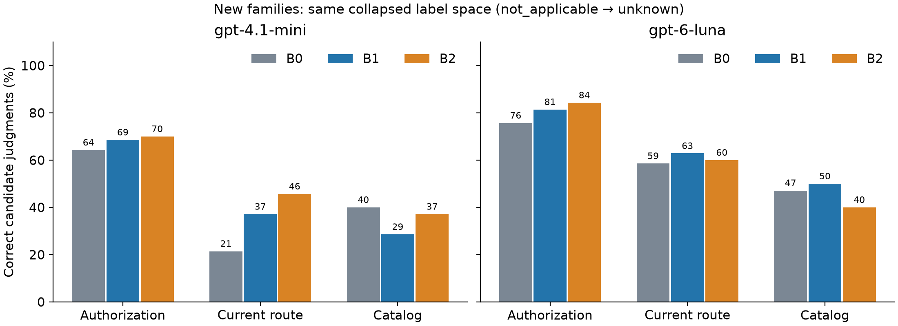
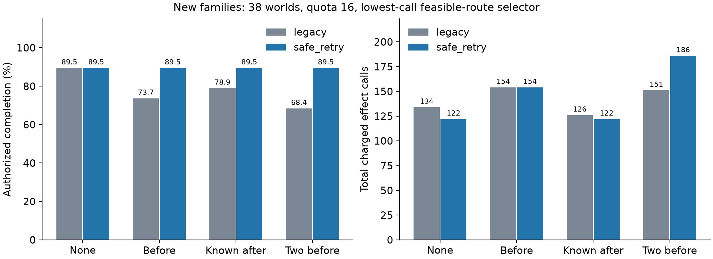

# 第七轮纯合成研究：适用性、执行证据与安全重试

本轮将三类问题分开：标签是否适用、模型是否判断正确、执行失败后能否合法恢复。确定性求解器与模型分别评价，避免把执行器算出的正确答案归功于模型。全部历史结果保留，未新增真实 Skill 实验或人工标注。

## 研究对象与证据范围

48个旧样本作为回归；独立编写12个新结构家族、每家族2个种子，共24个新样本。合计72个样本、94个公开世界、230个静态动作站点。新家族有38个世界、70个站点。新旧分开报告，不把旧样本重新称为留出。

独立参考解释器与生产执行器在868项原始/替代路线/站点屏蔽比较中全部一致；所有站点内容均被源码解析覆盖。四值标签、逐世界证据全部一致，not_applicable 折叠回 unknown 后也与上一版三值真值一致。确定性枚举在此有限规格内解决全部230个站点；这说明本轮不能以准确率证明必须使用LLM。

冻结后保留了两项基础设施失败：两个样本的函数字典遍历顺序导致覆盖检查误报；首次容器启动因模块排序先加载依赖方失败。两者经独立审查后新增版本修正，原记录、原冻结文件和480条模型请求均保留。详见[修正记录](phase7_amendment.md)。冻结是本地流程记录，不是外部预注册。

## unknown 的减少究竟意味着什么

新真值将“站点未执行”“原路径已失败，无法问当前路径必要性”“目录中没有合法成功路线”标为 not_applicable。开放目录、世界间意见不一致、部分世界适用而另一些不适用，仍可能是 unknown。适用性变化不是模型学到了更多信息。

| 数据 | 轴 | yes | no | unknown | not_applicable |
|---|---|---:|---:|---:|---:|
| 旧样本160站点 | 授权 |126|7|11|16|
| 旧样本160站点 | 当前路径必要性 |109|18|15|18|
| 旧样本160站点 | 目录必要性 |75|45|22|18|
| 新家族70站点 | 授权 |44|2|14|10|
| 新家族70站点 | 当前路径必要性 |32|6|18|14|
| 新家族70站点 | 目录必要性 |12|26|22|10|

例如新家族授权轴的旧式 unknown 总量为24，其中10项只是统一不适用，14项仍有真正的聚合不确定性。拆分能解释 unknown，但不能把这10项重命名当作模型能力提高。新家族授权 no 仍只有2项，否定类覆盖明显不足；因此不能据新结果声称广泛拒绝能力得到验证，也不能事后替换样本美化覆盖。

## 模型对照与可执行证据

同一次新采集中，B0为旧三值协议，B1为明确区分适用性的四值协议，B2在B1上增加逐世界证据。输入事实相同、输出上限均为4000 tokens。432主条件加48额外重复，共480个不同请求；全部返回，477协议有效。主条件429/432有效。失败为两条mini B2漏候选、一条Luna B0多个输出文本块，均保留并计入错误分母，没有补跑。

为与B0公平比较，下表统一将 not_applicable 折叠为 unknown；每项分母均为新家族70站点。

| 模型 | 协议 | 授权正确 | 当前路径正确 | 目录必要性正确 |
|---|---|---:|---:|---:|
| GPT-4.1 mini |B0|45|15|28|
| GPT-4.1 mini |B1|48|26|20|
| GPT-4.1 mini |B2|49|32|26|
| GPT-6 Luna |B0|53|41|33|
| GPT-6 Luna |B1|57|44|35|
| GPT-6 Luna |B2|59|42|28|

授权有温和改善，但必要性没有跨模型、跨数据组的稳定改善。旧160站点上，Luna当前路径B0→B1从101降至89，目录必要性却从43升至77；mini目录从81降至65。不能概括为“新协议全面更好”。家族配对区间与逐轴混淆均在结构化结果中，属于探索性比较。

更关键的是四值指标揭示了折叠表掩盖的问题：新家族当前路径轴，mini B1/B2仅10/70、16/70正确，Luna仅34/70、32/70正确。mini B1把64/70项都答成 not_applicable，其中54项并非统一不适用；32个应为yes的站点全部被误判不适用。真正unknown的18项中，mini B1/B2均识别0项，Luna均只识别1项。unknown变少，很大程度上变成了另一种误判，而非解决了不确定性。

**B2完整证据通过率为0/144。** 全部主条件460个候选判断仅5个通过，且都来自回归集；两模型新家族均无候选证据通过。完整证据的选择性准确率因此未定义，不能写成100%。按原始四值标签，新家族mini当前路径从10提升到16，Luna从34降至32；目录mini13→16、Luna21→20。证据格式未产生稳定收益。

事后描述性诊断进一步定位了失败：[证据错误明细](../results/phase7/analysis/evidence_diagnostics.json)。142个协议有效的B2主条件共有454个候选、592个候选—世界对；合法成功路线集合有542处错误，屏蔽目标后的成功状态276处错误，避免目标身份的路线312处错误。世界索引和世界数量没有发现错误，路线集合差异也不是单纯排列顺序。28/142份回答在不同候选间给出了互相矛盾的同一世界合法路线集合；300/454个候选标签甚至与自己给出的证据不一致。因此零覆盖不能仅解释为检查器对格式过严，也暴露了模型未完成要求的执行推导。

这一失败也反映设计问题：每个候选重复填写全局路线事实，增加冗余和一致性负担；整份证据必须全部正确才能放行，具有全有或全无的脆弱性；检查器为核验事实已完整枚举，模型没有节省确定性工作。B2主条件输出tokens约为B1的2.8–2.9倍，保守API费用约增加47%，却未取得可用的完整证据。下一版应把每世界的全局执行事实只记录一次，并以工具产生的轨迹派生标签；是否有模型收益必须另测，不能把这类重新设计计成本轮成功。

24个三次重复组中仅5组三轴标签完全一致（不含逐世界证据）；即使协议有效，也不能把单次答案当作稳定行为。下图是粗粒度描述，须与四值失败分析一起阅读。

## 恢复修复、强对照与成本取舍

6,016个恢复条件覆盖所有94个世界、两种配额、两种同等模拟能力的选路器、两种重试策略和8种故障安排。1,504项原四种故障下的 legacy 对照与冻结第六轮结果逐字段一致。13个成功隔离容器批次与本地VM结果完全一致。

新策略只根据已观测错误行动：安全的提交前瞬时失败或带已知收据的提交后失败可重试同一路线；静态拒绝/路径无法完成等错误转入替代路线；未知提交结果立即停止。共享权限、收据、4次实际尝试与调用配额不变，不清除冲突收据以强行达成目标。两选路器每次决策都完整模拟剩余目录，因此比较的是选路，不是一个能规划而另一个不能。

| 新家族38世界；配额16；最低调用数选路 | 成功：旧→新 | 总调用：旧→新 |
|---|---:|---:|
| 无故障 |34→34|134→122|
| 首次提交前瞬时故障 |28→34|154→154|
| 首次提交后、结果已知 |30→34|126→122|
| 第二次提交前瞬时故障 |32→34|168→140|
| 第二次提交后、结果已知 |32→34|158→122|
| 连续两次提交前瞬时故障 |26→34|151→186|

全部3,008个新旧策略配对中，新策略增加154个成功条件，没有成功退化；这些条件相关，不能当作3,008个独立任务或新的统计样本。首次瞬时故障在新家族的微平均改善为6/38；家族均衡改善为12.5个百分点，探索性95% bootstrap区间[0,25]。连续两次故障为16.67个百分点，[4.17,29.17]。多重比较未经确证校正。

连续故障的调用增加并不只来自“多完成了任务”。在新旧都成功的26个世界中，最低调用数选路仍从110调用升至133调用。轨迹显示，新策略优先重试原路径，可能随后才发现永久拒绝或收据冲突，也可能完成较长原路径；旧策略有时更早切到廉价替代路径。因此“安全可重试”不等于“值得立即重试”，本轮没有证明成本反转已被普遍消除。

新家族无故障仍有4个世界无法合法完成，均涉及 permission_split/deferred_report 中缺少必要授权。未知提交故障触发时安全停止，也不能当作重试缺陷；故障未触发的条件另列。全部恢复条件没有未授权提交或重复副作用，这首先是可信网关和收据机制的性质。

## 端到端结果与归因

完成7,776个源码→模型授权门控→可信网关→恢复条件：原始模型5,184、证据核验门控1,728、确定性参考门控864。16个成功容器批次与本地完整轨迹一致，没有未授权提交、重复副作用或超额调用。必要性标签仍不参与运行门控。

在新家族world0、配额16、最低调用数选路、首次瞬时故障下，原始模型旧策略成功22/24（Luna B2为23/24），新策略全部24/24；求解器门控22→24。完整证据全部拒绝后，原始路径放行集合始终为空，但替代路线仍能经可信授权网关恢复：旧策略18/24，新策略24/24。

**这不证明证据方法成功。** 所有新家族证据门控任务都转入替代路线。无故障时，这种全部阻断的路径只用55次调用，少于求解器84次、原始模型80–83次，是因为公开目录提供了廉价替代路径，不是模型证据更好。24/24成功还掩盖了语义质量差异。`route_bypass`只统计替代路径实际提交副作用，因此其中20例为true，另4例通过空替代路径确认已满足目标；“选择了替代路线”和“替代路线提交了效果”不能混为一谈。

端到端只执行world0，恢复网格则执行全部38个新家族世界；其余4个不可行世界属于world1，故24/24与34/38不矛盾。求解器按所有世界聚合后的yes放行，是保守参考门控，也不是运行成功率理论上界。零未授权效果属于可信网关提供的安全边界，不能证明模型拒绝能力。

## 可以主张的研究价值和仍然明显的限制

可以支持一个有限语义机制研究：区分适用性与信息不确定性；用独立执行轨迹定位模型对当前路径/替代路径的混淆；证明恢复策略中的路线过早移除与无条件重试会损害完成率；展示成功率、实际调用和规划开销之间的取舍。

这些结果不能证明真实 Skill 检测有效、通用提示注入安全、任意程序泛化或图结构的稳定收益。本轮没有新增图边因子，上一轮缺乏跨模型稳定收益的结论不变。标签解释和合法恢复尚未稳定时，增加图表示会引入更多归因困难；图边只提供结构关联，也不能替代目标干预、授权及目录语义。

仍有明显边界：新家族只在相同有限语言中组合已有操作；授权否定类稀少；所有世界、目标和替代路线都公开；必要性轴仅用于评价，只有授权轴进入门控；模型没有自由生成计划或调用真实工具；证据核验本身可以穷举答案；故障只覆盖规定的有限提交位置。模型比较包含标签命名、适用性说明和提示清晰度的联合变化，不能把B1收益单独归因为新增一个标签。

下一步应优先：在生成前约束每轴/每类覆盖并验证真正的结构距离；将“安全重试资格”与“重试还是切换的成本决策”分离，用独立故障分布评价；若继续使用模型证据，应先比较能否减少确定性搜索成本，而非在完整穷举后宣称模型优势。新的协议与数据必须另行冻结，保留本轮负面结果。

## 费用、完整性与复现

本轮新增保守费用 **$0.272429900**，累计 **$16.667120650**，授权剩余 **$12.884454475**。480个当前请求均结算；184个历史未确定预留条目继续保留，账本继承前缀逐字节不变。金额是保守核算，不是供应商发票。

采集完成后的费用进度打印发生并发读取错误；全部回答与账本已经保存，仅最终汇总缺失。通过新增读取锁和纯离线重建汇总处理，新增请求为0，原代码与失败记录保留，见[采集后修复](phase7_postacquisition_repair.md)。

最终全量测试 **951 passed、4 skipped、150 subtests passed**。全部25,812个基线文件按字节核验；13,792个执行条件通过29个成功批容器重放，另保留1次初版启动失败。发布核验还重算原始响应解析、独立语义、全部执行、分析和预算；见[发布验证](../results/phase7/provenance/release_verification.json)及[结果审查](phase7_outcome_review.md)。

[结构化统计与区间](../results/phase7/analysis/summary.json) · [逐候选](../results/phase7/analysis/candidate_scores.jsonl) · [失败轨迹索引](../results/phase7/analysis/execution_failures.jsonl) · [复现步骤](phase7_reproduction.md) · [独立审查](phase7_review.md)
