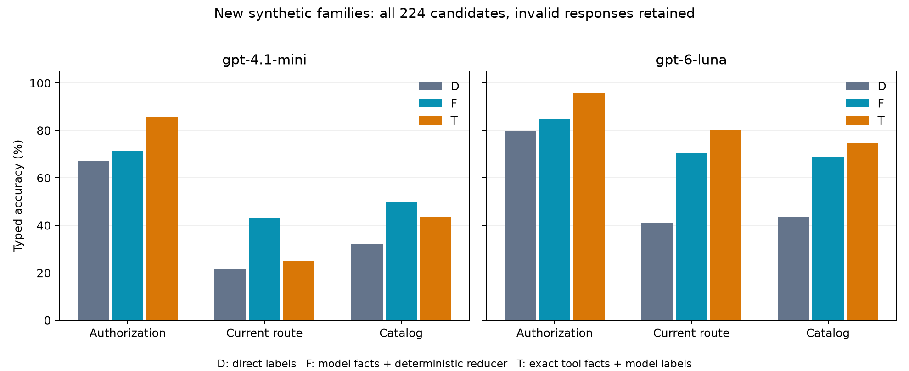
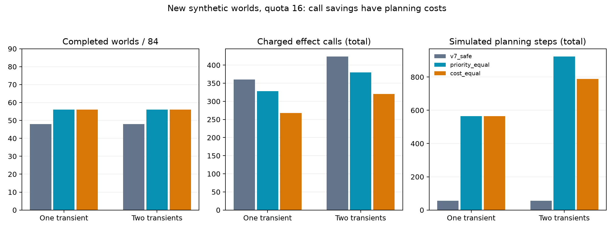

# Phase 8：事实分解、经济恢复与审计—执行接口

本轮完成了新的纯合成实验。最主要的发现是：**用程序汇总逐世界事实，能明显减轻必要性判断中的误用“不适用”；但完整事实仍不可靠，标签改善也没有稳定转化为端到端完成率改善。** 恢复阶段加入可行性检查和成本比较后，减少了实际调用并补回部分失败；代价是更多规划计算。

这些结果支持把研究重心放在“可执行事实、确定性汇总、与当前执行状态一致的决策接口”。它们尚不支持“模型能可靠证明 skill 安全”或“模型证书优于确定性求解器”。

## 1. 本轮做了什么

- 保留 Phase 7 的 24 个新样本作为旧回归集；独立构造 48 个新样本，12 个结构家族，每家族四个变体。
- 合计 72 个任务、122 个世界、294 个候选点。新样本占 84 个世界、224 个候选点。
- 新样本有 20 个无替代路线任务、36 个多世界任务；明确 authorization=no 的候选从上轮新集的 2 个增加至 12 个。
- 新程序的 12 个归一化结构与此前 72 个原程序、186 个原程序及替代程序均无完全重复。最近结构 token 编辑距离中位数 44.5。每家族四个变体共享结构，不能算成 48 个独立结构；距离不是语义难度，也不是新语言泛化证据。
- 432 个主要模型请求，加 48 个重复请求，共 480 个；全部获得 completed 响应，476 个协议有效。主要请求中 429/432 有效；四个无效响应都是 F 的世界覆盖错误，没有被重试或从分母删除。
- 独立参考解释器与生产实现完成 972 项执行/干预对照，全部一致；完整候选覆盖、类型标签、逐世界事实也一致。
- 恢复 5,856 个条件、端到端 8,784 个条件，共 14,640 个条件；37 个受限容器批次逐项复现 VM 结果。每个批次最多 400 个条件，不是 14,640 个容器。

方案和分析问题在请求前冻结。数据作者没有读取生产模块或模型结果；生产作者在代码冻结后才读取新样本。分析实现允许在采集期间完成，完成时已收到部分结果摘要，相关时间边界单独记录；这里不声称分析源码在结果出现前冻结，也不声称外部预注册。

## 2. 三组模型对照说明了什么

| 组别 | 模型负责什么 | 程序负责什么 | 比较边界 |
|---|---|---|---|
| D | 直接给三个类型标签 | 只校验格式和覆盖 | 延续 Phase 7 B1 的直接判断 |
| F | 每个世界的执行事实；全局事实只写一次 | 按固定规则汇总标签 | 同样的公开源输入，但同时改变事实表示与汇总责任 |
| T | 从工具给出的准确事实汇总标签 | 先完整执行求出事实 | 定位汇总瓶颈的增强对照，不是同等计算量的语义对照 |

三组均使用最多 4,000 输出 token。D/F 公开数据相同；T 每个模型在新集所需工具事实的逻辑求解量为 524 次有限解释器执行，这不包含离线评分、校验和重放的重复运行，也不是耗时测量。确定性求解器本身已经能得到全部正确标签，因此不能把 T 解释为 LLM 带来了求解加速。

新集每个轴的分母均为 224；无效输出按错误计入：

| 模型/组别 | 授权正确 | 当前路线必要性正确 | 目录内必要性正确 |
|---|---:|---:|---:|
| mini / D | 150 | 48 | 72 |
| mini / F | 160 | 96 | 112 |
| mini / T | 192 | 56 | 98 |
| Luna / D | 179 | 92 | 98 |
| Luna / F | 190 | 158 | 154 |
| Luna / T | 215 | 180 | 167 |

F 相对 D 的“当前路线必要性”家族均衡改善：Luna +30.90 个百分点，探索性 95% 区间 [12.81, 47.53]；mini +21.49 个百分点，[3.26, 39.90]。只有 12 个新家族，多重比较未校正；不能据此推广到任意程序。

T 的结果很有诊断价值：准确执行事实并没有让 mini 正确汇总必要性，当前路线轴仍仅 56/224。这里剩下的错误不能归因于工具执行事实不准确，但也不能简单归因于某种模型内部机制；提示遵循、规则应用和多世界汇总都可能参与。

## 3. unknown 和“不适用”改善了多少，还剩什么

当前路线轴有 64 个真实 unknown、48 个真实“不适用”。

| 模型/组别 | 正确认出 unknown /64 | 错误预测 unknown | 错误预测“不适用” |
|---|---:|---:|---:|
| mini / D | 0 | 0 | 175 |
| mini / F | 33 | 43 | 16 |
| mini / T | 0 | 0 | 135 |
| Luna / D | 9 | 5 | 87 |
| Luna / F | 43 | 15 | 7 |
| Luna / T | 44 | 9 | 32 |

F 确实减少了把正常可判断场景全部归入“不适用”的问题。但 mini 又增加了 43 个错误 unknown，不能仅用 unknown 召回率宣布问题解决。真正应保留的 unknown 包括世界之间分歧、部分世界不适用、开放目录缺少充分见证；它们不能靠强行输出 yes/no 消除。

完整事实正确性依然很低：新集 mini 为 0/48，Luna 为 1/48；旧回归集两模型均为 0/24。新集全局合法路线集合，mini 只对 31/84 个世界，Luna 40/84；干预后的成功事实，mini 为 219/388 个候选—世界组合，Luna 257/388（均包含无效响应分母）。局部标签正确不代表其完整解释正确。

唯一完整事实正确的 Luna 响应只有四个候选点；其条件标签准确率 100% 只是 4/4，另外三组条件准确率因分母为零而未定义。不能把这一指标当作可靠证书的证据。24 个三次重复组中，只有 7 组标签完全一致；12 个 F 组中只有 2 组完整事实一致。一致也不保证正确。

F 不是免费改进：新集平均输出 token，mini 从 D 的 135.8 增至 300.5，Luna 从 143.4 增至 316.6；保守 API 费用分别约增加 34.6% 和 35.6%。本轮没有单独隔离“全局事实只写一次”与“确定性汇总”的因果贡献。

## 4. 与修复前的同样样本相比

同一批 24 个旧样本、70 个候选点，比较 Phase 7 B2 与本轮 F 的严格类型标签：

| 模型 | 授权 | 当前路线必要性 | 目录内必要性 |
|---|---:|---:|---:|
| mini | 48 → 51 | 16 → 31 | 16 → 36 |
| Luna | 56 → 67 | 32 → 51 | 20 → 41 |

这是跨时间、跨协议的描述性比较，不是把上轮 70 个候选与本轮 224 个候选直接拼成同一试验。新鲜 D/F 配对更适合衡量本轮方案差异。两个模型在旧集的完整事实正确响应仍为零，证书瓶颈没有消失。

## 5. 合法恢复：调用节省真实存在，但规划开销必须一起算

新增两个策略使用相同的信息和相同的候选模拟：priority_equal 在安全且可完成时优先重试；cost_equal 在同样可行的路线中选择剩余调用最少者。模拟遵守原路线模型门控、精确权限、当前文件、既有回执和剩余配额；看不到未来故障。第一步仍按实验约定尝试原路线，最多四次实际尝试。

新集 84 个世界、配额 16 的两个预设场景：

| 故障 | 策略 | 完成 /84 | 实际调用总数 | 规划步数 |
|---|---|---:|---:|---:|
| 一次临时故障 | 上轮 safe_retry | 48 | 360 | 56 |
| 一次临时故障 | priority_equal | 56 | 328 | 564 |
| 一次临时故障 | cost_equal | 56 | 268 | 564 |
| 两次临时故障 | 上轮 safe_retry | 48 | 424 | 56 |
| 两次临时故障 | priority_equal | 56 | 380 | 924 |
| 两次临时故障 | cost_equal | 56 | 320 | 788 |

把新集两个配额、八种故障全部计入，每策略 1,344 个相关条件：上轮成功 580，两个新策略均 636。cost 相对 priority 在 636 个双方成功配对中减少 320 次调用，没有观察到成功损失；相对上轮增加 56 个成功条件，双方成功的 580 个配对减少 360 次调用，同时增加 3,288 个规划步骤。

这些成功改善集中于少数家族；各配额/故障分层的收益区间均包含零。模拟步数与外部调用不是同一成本单位，尚未给出部署环境的净费用或延迟收益。额外玩具测试还展示了未来故障改变时成本策略可能输掉；它不是成功率支配保证。未知提交结果仍然安全停止，不能计成应该重试而没有重试的缺陷。

## 6. 端到端暴露了审计—执行接口问题

本轮检查全部世界，并加入 all_allow、all_block 和确定性审计门控。授权以外的两个必要性轴仍是诊断指标，没有参与门控，因此它们的准确率提高不能直接归因到执行成功。

旧回归集每条流水线 304 个条件全部门控不敏感，每条均成功 272 个。新增样本则有每条流水线 192 个门控敏感条件（跨两策略、四故障；不是 192 个独立任务）：

| 流水线 | 敏感条件成功 /192 |
|---|---:|
| mini D / F / T | 152 / 120 / 128 |
| Luna D / F / T | 144 / 80 / 104 |
| 确定性跨世界审计门控 | 96 |
| all_allow / all_block | 160 / 32 |

标签变好而执行变差，至少有三种不同原因。

1. **跨世界审计与当前世界决策不等价。** 每个模型均有 32 个 D 成功、F 失败的相关条件：F 正确输出全局 unknown，但当前世界授权为 yes。统一“仅全局 yes 放行”过于保守。确定性审计门控也受影响，因而不是当前世界成功率上界。
2. **协议失败仍有实际代价。** 每个模型另有 16 个此类损失条件源于无效 F 响应的空门控。这里不是模型 API 失败，而是世界清单覆盖不完整或多报。
3. **执行原路线有时先损坏恢复机会。** all_block 赢过 all_allow 的 32 个条件全部来自 shared_emit_key 家族：原路线先留下事件或共享回执，后续路线无法同时满足精确事件计数和回执约束。提前阻止原路线能保持干净状态，再走替代路线。此时错误的阻止也可能偶然提升成功率，不能把成功率当作标签正确性的替代指标。

后一点还说明，审计中的无去重因果执行语义与实际带回执、去重的执行语义必须区分。它们各自在独立实现间一致，但不意味着理想语义上的成功路线在带状态网关中也可完成。应在第一个副作用前按实际执行语义做可行性预检。

以上分解是事后诊断，没有据此修改本轮模型提示或策略。全网格无越权、重复副作用和超配额，证明的是受测有限网关在这些条件下满足不变量；不能把保护效果算成模型拒绝能力。

## 7. 下一步应怎样改

优先级一：修正审计到执行的接口。保留全局 unknown，同时输出逐世界的条件授权；实际执行只接受可信观测能证明的当前条件。如果世界仍不确定，应请求最小可信观测或安全停止，不能假设有“世界真值 oracle”。先做实际回执语义的预检，再产生第一个副作用。

优先级二：把类型汇总和适用性判断固定为程序。模型可提出事实候选、待查询位置或见证；能由工具获得的关键事实交给工具验证。用等查询预算的“模型引导查询、确定性启发式查询、完整求解”对照，检验模型是否真正减少查询，而不是先完整求解再检查模型。

优先级三：把成本策略扩展为明确的多目标决策。分别计调用、规划、延迟和未知提交风险；缓存可复用模拟事实，设置相同规划预算，并增加预先登记的未来故障变化。当前最少调用不是风险最小或总费用最低的保证。

优先级四：再做拆分消融和更独立的结构家族。单独比较全局事实去重、确定性汇总、工具事实、前置预检。沿用完整标签分布和结构距离审计，扩大的是独立结构/故障机制，不能只复制变体。图边没有在本轮重新随机化测试，不能声称本轮证明了图的收益；应在关键事实与执行接口稳定后，用等信息、等预算对照定位图是否减少查询。

## 8. 完整性、费用与成果定位

本轮保守 API 费用增量 **$0.325077400**；累计上界 **$16.992198050**，剩余 **$12.559377075**。原有未知结算预留继续保留；这些是保守核算，不是账单。价格依据本轮核对的 [Luna 官方模型页](https://developers.openai.com/api/docs/models/gpt-6-luna) 与 [mini 官方模型页](https://developers.openai.com/api/docs/models/gpt-4.1-mini)，没有给缓存命中折扣记账。返回模型标识为 gpt-6-luna 和 gpt-4.1-mini-2025-04-14。

所有旧结果保留。本轮未执行真实 Skill、未新增人工标注。分析无参数入口的一处局部变量遮蔽错误已修复，原分析检查点及修复记录保留；再次计算分析输出逐字节一致。事后门控诊断 V1 将“没有观察到门控事件”的占位值误写成 invalid，V2 改为 null 并增加原因类别；V1 及其复现脚本保留。两项都没有改变请求、原始响应、执行结果或主要统计。

最终本地测试为 1,032 项通过、4 项跳过、150 个子测试通过。一轮验证因 Windows 临时文件绝对路径达到 260 字符，导致四项旧测试无法创建模拟响应文件；缩短测试临时目录后全部通过，没有修改旧测试或生产代码。失败记录和最终测试记录均保留在 validation 目录。

这项研究现在有意义的主张是：在有独立可执行真值的有限工作流中，分离事实与类型汇总能改善某些判断；更严格的审计结论可能与当前执行目标冲突；安全恢复中的可行性与经济选择应分开评估。它适合作为机制研究和可复现实验框架。若写成普适的 prompt-injection 防御、真实 skill 安全认证或图推理优势论文，仍会有明显证据缺口。

## 证据索引

- [方案](phase8_design.md)、[预设分析](phase8_analysis_plan.md)、[复现说明](phase8_reproduction.md)
- [结构与覆盖审计](phase8_reference.md)、[恢复实现](phase8_recovery.md)
- [实施前审查](phase8_prefreeze_review.md)、[结果独立审查](phase8_outcome_review.md)
- [完整统计](../results/phase8/analysis/summary.json)、[事后门控诊断 V2](../results/phase8/diagnostics_v2/summary.json)
- [请求清单](../results/phase8/acquisition/manifest.json)、[API 汇总](../results/phase8/api/summary.json)
- [最终复现与旧文件校验](../results/phase8/provenance/release_verification.json)
