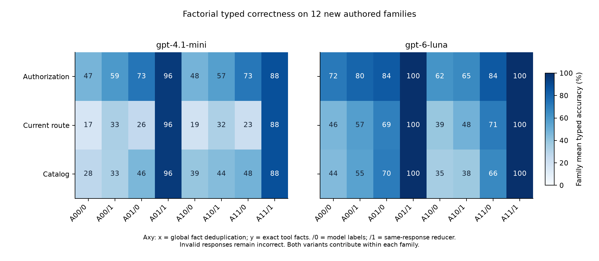
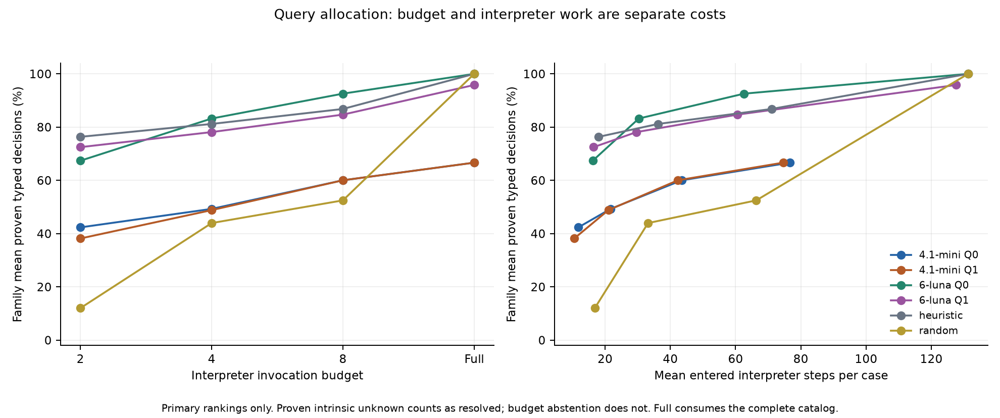
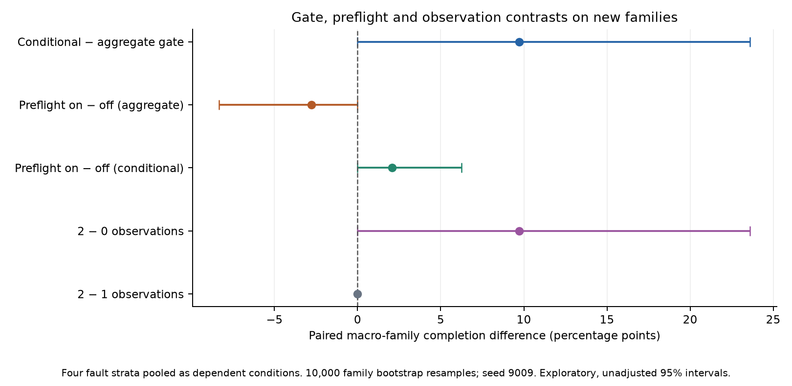
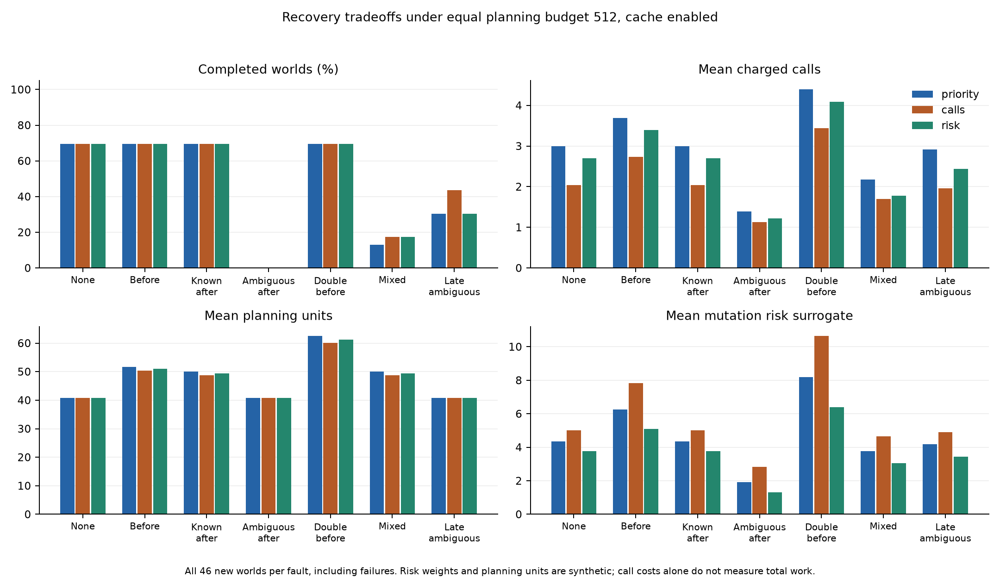
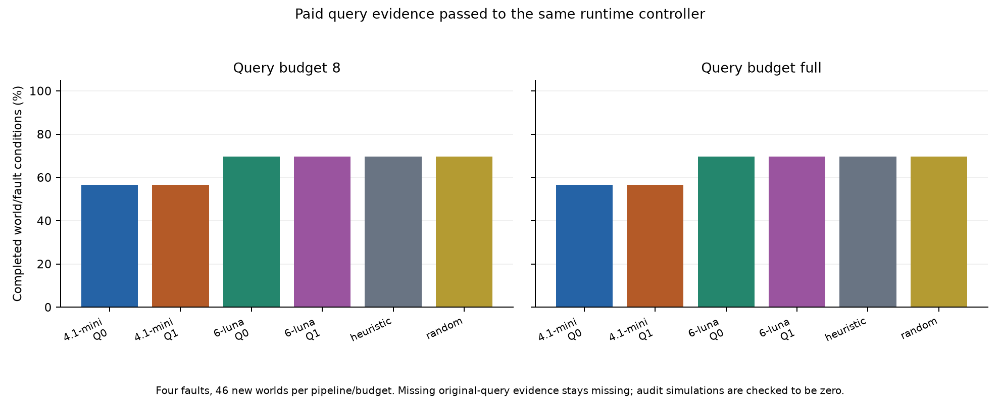

# Phase 9 实验报告：可信观测、查询分配与恢复边界

本轮完成了上一轮提出的四项实现与实验：条件化授权和执行前预检、固定类型汇总与等预算查询、多目标恢复及缓存、拆分消融与新结构测试。结果支持其中一些机制，但不支持“所有组件都改善完成率”。最明确的结论是：**程序汇总和工具事实各有贡献；可信观测能解除部分保守阻止；模型在局部查询分配上可能有价值，但图没有显示稳定收益；预检和风险偏好仍有可用性代价。**

所有旧结果保留。本轮只使用合成任务，不进行真实 Skill 实验和人工标注。可恢复存档为远端标签 [archive-phase8-20261016](https://github.com/victorcao1104/taskskillguard-research/tree/archive-phase8-20261016)，对应提交 `93eda0d23236912671c7b309eb78e7c80fd20db1`。

## 1. 设计与证据范围

独立作者先在未查看新生产代码和模型输出的情况下设计24个任务，包含12个结构家族、46个世界、144个候选操作；每个家族两个变体，因此不能当作24个独立机制。实现与分析方案冻结后才生成正式测试数据，生成结果与作者第一版的哈希完全一致。全部72个旧任务另外保留为执行回归。

新原始程序相对120个旧原始程序和266个旧原始/替代程序均无归一化 AST 重复。距离审计保留了归一化的局限：名字、常量和别名身份被擦除，目标与权限不在结构距离中，两个变体共享骨架，新替代路线也不被宣称为新结构。这是同一有限 DSL 内的结构外推，不能解释为现实语言或真实 Skill 的泛化。

| 新集标签分布 /144 | yes | no | unknown | not_applicable |
|---|---:|---:|---:|---:|
| 授权 | 80 | 4 | 40 | 20 |
| 当前路线必要性 | 36 | 6 | 74 | 28 |
| 目录内必要性 | 13 | 34 | 61 | 36 |

未知与不适用不是失败占位符；这些值首先来自独立可执行真值。小类别尤其稀疏，例如授权 no 只有4个候选，不能据此估计广泛拒绝能力。

本轮336次模型请求均取得 completed 响应：288次主要请求，48次事先固定的重复请求。302次通过协议验证，其中主要请求257/288通过。34次失败由13次世界覆盖错误、17次查询排列错误、2次重复事实不一致、1次路线索引错误、1次多个输出文本组成。没有 API/网络失败，也没有补答、拼接多个输出或用真值修复模型答案。重复请求不增加统计上的独立样本数。

96个任务共438个候选点、168个世界；独立参考与生产解释器的1,484项执行/抑制比较全部一致。查询实验有672个条件、404个完整目录顺序前缀检查，所有已证明的标签——包括已证明的 intrinsic unknown——均与独立真值一致。执行实验共9,800个条件，26个无网络、只读、无宿主挂载、非root容器的结果与本地解释器一致，受测条件中没有越权提交、重复副作用、超调用配额或超规划预算。

区间均为按家族等权的配对 bootstrap，10,000次重采样、种子9009，未做多重比较校正。世界、故障、策略、变体是相关条件，不是9,800个独立安全样本。这些区间是探索性证据。

## 2. 汇总器与工具事实的贡献被拆开了，去重没有独立优势

本轮每个响应同时输出事实和模型自己的标签，再对同一份事实做程序汇总。A00/A01/A10/A11分别表示“全局事实重复/只写一次”与“无/有完整工具事实”的组合；汇总器0/1分别使用模型标签或程序推导。这样能够隔离汇总规则的效果，而不是像上轮 F−D 一样同时改变事实表达和输出任务。

下面每格是“模型标签正确数 → 同一事实经程序汇总的正确数”，分母均为144，协议无效仍计错。

| 模型 | 事实形式 / 工具 | 授权 | 当前路线必要性 | 目录内必要性 | 有效响应 /24 |
|---|---|---:|---:|---:|---:|
| mini | 重复 / 无 A00 | 69→87 | 23→51 | 41→49 | 21 |
| mini | 重复 / 有 A01 | 102→137 | 34→137 | 66→137 | 23 |
| mini | 去重 / 无 A10 | 69→83 | 26→49 | 58→65 | 22 |
| mini | 去重 / 有 A11 | 101→124 | 29→124 | 67→124 | 21 |
| Luna | 重复 / 无 A00 | 102→115 | 67→84 | 60→76 | 23 |
| Luna | 重复 / 有 A01 | 119→144 | 97→144 | 99→144 | 24 |
| Luna | 去重 / 无 A10 | 86→92 | 56→70 | 49→53 | 20 |
| Luna | 去重 / 有 A11 | 119→144 | 100→144 | 93→144 | 24 |

对其他因素取平均后，程序汇总在当前路线必要性上的家族等权效果为 mini +41.08个百分点，95%区间[27.43,53.47]；Luna +20.01，[9.72,31.47]。工具事实的对应效果为 +32.55、+37.34个百分点。三轴上的汇总器和工具事实主效应均为正且区间不含零，具体交互见结构化统计。

**单独去重没有显示稳定好处。** 多数去重主效应区间包含零；Luna目录必要性为−7.76个百分点，区间[−16.32,−0.12]。因此，上轮 F 的收益不能继续笼统归因于“事实只写一次”。本轮较复杂的新结构中，事实生成和世界清单覆盖仍是瓶颈。

工具事实已经由完整有限求解器产生，不能把这部分额外计算隐藏起来，或把其正确性归功于模型推理。Luna“工具事实+程序汇总”达到144/144，是受测有限语义下的结果；mini仍会因世界覆盖错误损失整份答案。若完整求解本身可负担，直接使用求解器就能得到精确标签，没有必要让模型再复制事实。

## 3. 模型查询有局部价值，图仍没有稳定收益

模型只看到公开源代码、世界/权限/目标和查询清单，输出一次完整查询排序；Q1额外附加由相同源代码确定性生成的图边，Q0不附加。工具只执行排序前缀，不先完整求解再把答案提供给模型。启发式和随机排序使用同一查询目录和相同调用上限。

| 查询上限8 | 证明的类型标签 /432 | 有效排序 /24 | 实际解释器调用 | 实际解释器步数 |
|---|---:|---:|---:|---:|
| mini Q0 | 248 | 16 | 122 | 1,043 |
| mini Q1 | 248 | 16 | 122 | 1,015 |
| Luna Q0 | 397 | 24 | 186 | 1,502 |
| Luna Q1 | 361 | 23 | 178 | 1,454 |
| 固定启发式 | 372 | 24 | 186 | 1,704 |
| 固定随机顺序 | 216 | 24 | 186 | 1,592 |

“证明”包括明确证明全局 unknown；因预算不足而输出 unknown 不计入证明。无效排序执行零次查询，所以不能把 mini 更少的实际调用解释为更节省。

Luna Q0相对启发式，在相同186次调用下证明更多标签、解释器步数也更少。家族等权证明比例提高5.75个百分点，区间[0.69,10.94]；12个家族中5个正向、3个负向、4个持平。完整排序中首次全部标签获得证明的位置平均提前4.125次查询，区间[−7.125,−1.208]。后者是排序的潜在提前停止位置：注册执行器仍执行固定前缀，并没有在达到证明后实际停止，因此不能把它写成已部署系统的实际调用节省。

Luna Q1−Q0在预算8时为−7.87个百分点，区间[−17.13,−1.16]；mini为0，区间[−16.44,15.97]。本轮不支持图的查询收益。Q1的输入来源与Q0相同，图只改变表达方式，并增加提示长度；这个对照不能把表示、长度和模型遵守协议的影响完全分开。Luna有一个Q1响应包含多个输出文本，mini Q0/Q1各有8个主要排序无效，因此主要效应包含“是否正确输出完整排列”和“排列是否高效”两部分，不能全归因于排序推理能力。

12个三次重复的查询组只有mini的2组排序完全相同，Luna为0组；不同顺序不一定导致不同效率，但也不支持输出顺序稳定的主张。

## 4. 条件授权改善了执行，预检仍可能妨碍信息获取

控制器不读取实际世界编号。环境持有真实状态，控制器只能根据公开的有限世界假设、允许的可信观测及可见执行历史缩小可能范围。全局授权 unknown被保留；当前条件能证明安全时才放行，观察不到的差异继续保持不确定。全局yes门控是对照，不被当作当前世界成功率上界。

下表使用相同quota16、四种故障条件和calls策略；新控制器的规划预算为512。旧V8是相同任务的历史机制对照，其信息和规划方式有差异，因此不是单因素因果比较。

| 门控 / 预检 | 新世界条件完成 /184 | 旧回归条件完成 /488 |
|---|---:|---:|
| 原V8聚合求解门控 | 112 | 312 |
| 新聚合 / 关闭预检 | 112 | 322 |
| 新聚合 / 开启预检 | 104 | 280 |
| 新条件化 / 关闭预检 | 124 | 352 |
| 新条件化 / 开启预检 | 128 | 344 |

在新集预检开启的严格配对中，条件化门控相对聚合门控有24胜、0负，家族等权改善9.72个百分点，区间[0,23.61]。将可信观测预算设为0，完成数回到104；设为1或2均为128。24个收益都只需一次观测，集中于write_through_pointer和guarded_pair_join两个家族。第二次观测没有边际收益，不能用这些结果宣称跨家族普遍改善。

预检使用实际回执、签名和去重语义，能避免先污染状态再尝试恢复。条件化门控下，新集预检有4胜0负；但旧集有8胜16负，完成数352→344。16个损失均来自nested_noop_observer的有利实际世界：授权已安全，当前观测选择器不再提问；然而目标是否可完成仍因世界不同而变化，保守预检要求所有尚可能世界都可行，于是拒绝执行。

聚合门控下问题更明显：旧集预检0胜42负，新集0胜8负。部分未预检执行会先进行合法读取，随后才被门控阻止；这些读取缩小了世界范围，使替代路线可被证明可行。预检提前停止同时阻止了获得这些信息。这是**目标相关观测尚未纳入策略**的设计局限，不是世界真值泄漏，也不是应忽略的偶然噪声。当前实现适合保守预检，尚不是完整的主动信息获取策略。

## 5. 合法恢复是多目标权衡，低风险分数不等于更高成功率

三个策略看到相同候选路线和已观察状态，使用相同规划预算128或512，并分别优先重试、最少剩余调用、最小操作风险分数。缓存对照只复用完整状态/权限/回执/门控/配额匹配的模拟事实。规划单位计每次模拟加进入的解释器步骤；观测次数、真实调用、模型调用和模拟延迟分别记录。解析、缓存键构建、观测分离搜索等宿主计算不在解释器工作量中，不能把此指标当作完整CPU时间。

新增故障时序为“第一次已知提交、第二次提交不明”和“第三次提交不明”，在看结果前已固定。策略不能看未来故障；所有未来故障条件的第一次选择一致。

- calls相对priority：1,288个匹配条件中32胜0负，收益都出现在新增混合/后置故障时序；584个双方成功配对减少736次调用，同时增加976个合成风险单位。它反映较短路线可能避开后续故障触发位置，不是普遍成功率支配。
- risk相对calls：0胜24负，损失均出现在第三次提交不明的条件；592个双方成功配对减少1,736个合成风险单位，同时增加480次调用。预设权重read0/write1/delete2/emit8倾向用更多低权重写操作替代较短的含emit路线，反而增加触及第三次突变的机会。这些权重是合成代理分数，并未校准为真实故障概率。
- 缓存开/关：1,932个匹配条件没有完成率变化，总计节省912个规划单位，命中集中在pointer_chain_fold的部分故障条件；不是普遍规划加速证据。
- 24个规划预算耗尽条件均是pointer_chain_fold、double_transient、预算128；预算限制确实生效，没有暗中补算完整计划。

所有提交不明的执行都在最后事件处停止，不能将其视为可安全盲重试的“可用性bug”。调用、规划、延迟代理和风险的完整分层表及双方成功条件成本都保留，没有用一个事后选择的综合分数掩盖权衡。

## 6. 查询效率改善尚未转化为端到端完成率改善

本轮真实连接了“模型排序→付费工具查询→完成的原路线授权证据→可信观测→预检与执行”。未完成的查询模拟不提供正授权证据；缺失世界不被免费审计补齐。2,208个端到端条件的额外审计调用和步骤均为0，查询成本与规划成本单列。

在预算8和full两个水平，Luna Q0/Q1、启发式、随机顺序都完成128/184；mini两种表示均为104/184。Luna Q0的诊断证明效率改善没有增加本轮任务完成数。很多额外证明属于必要性轴，而当前执行门控只使用授权；此外，合法替代路线仍可由单独计费的可信规划器找到。

无效模型排序有时也能完成任务：每个预算下，mini Q0有32个、mini Q1有24个、Luna Q1有8个此类条件，依赖的是可信替代路线规划，不能归功于模型证据。随机顺序与模型完成数相同也不等于其诊断能力相同。

## 7. 与修复前相比，解决了什么、还缺什么

已解决的是实验可归因性与接口中的明确问题：全局unknown不再被直接等同于当前禁止；不再假设控制器知道实际世界；回执语义进入执行前检查；事实去重、类型汇总、工具事实可分别比较；模型、图和确定性启发式在同一查询目录下比较；恢复预算与风险、缓存、新故障时序均有可执行对照。冻结前独立审查另外修复了不完整查询证据的放行、生产/数据冻结连续性，以及对“已经证明unknown”的验证遗漏。

仍存在四类不同的不确定性：

1. **真值本身的unknown**：世界之间结论不同或目录开放；不能靠强迫模型输出yes/no消除。
2. **证据不足**：有限查询预算、未被允许的观测或目标相关信息未查询；必须明确来源。
3. **协议失败**：世界覆盖或完整排列错误；属于模型接口可靠性，不能当作语义unknown。
4. **提交结果不明**：运行期故障状态；安全停止与前面三类完全不同。

下一轮最值得改进的顺序是：先把目标可行性也纳入可信观测选择，允许受权限/副作用约束的信息获取动作；再把“输出整个排列”改成受约束的下一查询或有限子集协议，并单独测试遵约率和分配质量；随后加入真实的自适应提前停止，检验查询节省是否转化为任务收益；最后在多个预先固定的故障过程和风险权重下检验Pareto权衡。图应保留为消融因素，而不是预设必须有效的核心卖点。后续新评估应重新独立设计结构，当前暴露过的样本只能作为回归集。

本研究现在可以写成有限可执行工作流中的机制研究：**如何把审计不确定性转成受观测约束的执行决策，以及诊断收益为什么未必等于任务收益。** 不能写成通用prompt-injection防御、真实Skill安全认证或稳定图推理优势。两套解释器一致并不证明现实系统符合这套有限语义；独立作者和可执行真值替代了本轮人工标签，但没有消除外部有效性限制。

## 8. 完整性、费用与复现

29,195个原有跟踪文件保持字节不变，旧实验、旧报告和旧实现均可从存档标签恢复。本地完整测试记录为1,183项通过、4项跳过、150个子测试通过；随后新增分析边界检查的13项专门测试通过。分析作者一次过长临时路径导致4项旧测试无法创建文件，改用短路径后14项相关测试通过；该过程如实记录在分析说明，没有修改旧实现。最终CI会运行全部现有测试，离线验证器还会重新计算分析与保存的执行结果。

本轮费用上界增量 **$0.391094500**，累计 **$17.383292550**，剩余 **$12.168282575**；336个新预留全部结算，历史未决预留继续计入上界。最大预留曾为$2.708720700，没有超出单请求或累计限制。这是保守本地核算，不是提供商账单。价格按本轮核对的 [Luna官方模型页](https://developers.openai.com/api/docs/models/gpt-6-luna) 与 [mini官方模型页](https://developers.openai.com/api/docs/models/gpt-4.1-mini) 记录，未计缓存命中优惠。

结果和五组PNG/PDF图已经在独立进程中逐字节重算一致。关键索引：

- [完整结构化分析](../results/phase9/analysis/summary.json)、[分析口径](phase9_analysis_plan.md)、[分析实现说明](phase9_analysis_notes.md)
- [独立参考与结构审计](phase9_reference.md)、[协议](phase9_protocol.md)、[恢复说明](phase9_recovery.md)
- [冻结前审查](phase9_prefreeze_review.md)、[结果审查](phase9_outcome_review.md)
- [请求清单](../results/phase9/acquisition/manifest.json)、[费用与返回状态](../results/phase9/api/summary.json)
- [复现说明](phase9_reproduction.md)、[最终完整性验证](../results/phase9/provenance/release_verification.json)
