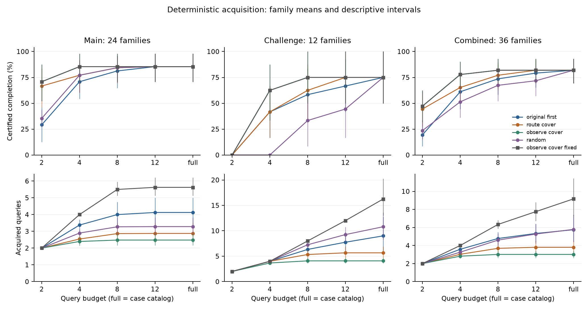
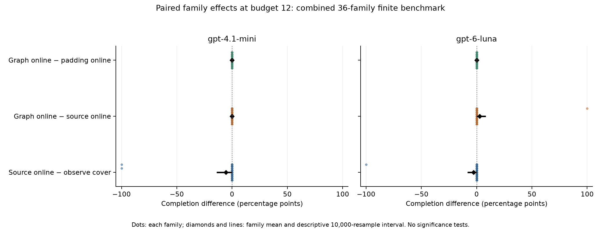
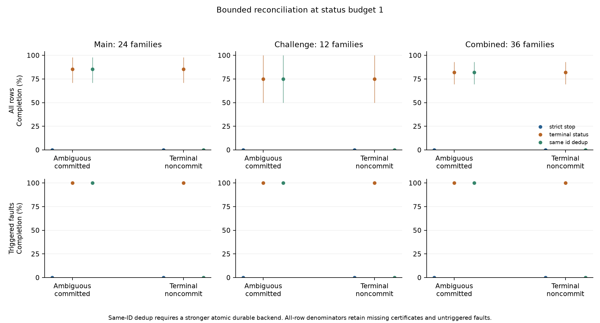

# Checkable Evidence Contracts for Bounded Agent Workflows: Stopping, Robust Infeasibility, and Commit Recovery

Research manuscript draft, Phase 11, 17 October 2026. Synthetic evidence only. This draft does not claim peer review, acceptance, or established publication novelty. The accompanying [claim–evidence matrix](claims.md), [Chinese report](../../docs/phase11_report.md), and [reproduction guide](../../docs/phase11_reproduction.md) specify its scope.

## Abstract

An agent can know that actions are authorized without knowing that a workflow will complete, and can lose an acknowledgement without knowing whether an effect committed. We study an explicit evidence interface for these two uncertainties in a bounded synthetic workflow language. An untrusted selector purchases execution receipts and initial observations; a separate checker accepts a fixed route only when it has successful receipts for every compatible world. Under finite-world coverage, truthful snapshot-bound evidence, fixed semantics, and a guarded executor, we establish positive-witness preservation, stable negative certificates, and a lower bound within this receipt language. A separate recovery transition distinguishes committed effects, fenced terminal noncommit, and unresolved outcomes.

Evaluation uses 24 independently authored structural templates plus 12 prospectively added challenge templates, 1,006 independently checked world–route executions, 12,320 acquisition conditions, 15,696 recovery conditions, and 288 live model-selection streams. Certificate stopping reduces the deterministic observe-cover policy's mean acquired queries from 7.750 to 3.014 at budget 12 while preserving its 81.94% family-mean completion. In the matched API-world comparison, GPT-6 Luna and GPT-4.1 mini complete 29/36 and 28/36 tasks, versus 30/36 for observe-cover, and use more queries. Graph augmentation does not outperform the locally token-matched padding control on completion. Terminal reconciliation restores acknowledged completion for all 178 certifiable triggered executions for each of two terminal fault types; some physical goals were already achieved before confirmation, and unresolved status does not authorize retry. We release append-only raw evidence, independent reference semantics, restricted-container replays, and offline verification. These results support a finite, reproducible mechanism study, not a general prompt-injection defense or a real-world Skill evaluation.

## 1. Problem and contribution

Three questions that are often conflated require different evidence: Is an operation authorized? Does a particular workflow safely complete the requested goal? Did an operation whose reply was lost already commit? A global diagnostic label need not answer the next execution question. Conversely, a permissive response to missing evidence can silently turn uncertainty into unauthorized or duplicate effects.

Our research questions are:

1. Can acquisition terminate on a checked goal-completion witness, with less acquired work than continuing the same policy to a fixed budget?
2. When is residual uncertainty an acquisition failure, and when does the permitted observation/route interface make robust completion impossible?
3. Do model-selected queries or redundant graph representations improve end-to-end completion over capable deterministic selectors?
4. What commit evidence permits bounded continuation after an ambiguous mutation, and where must continuation stop?

The contribution is an executable integration and evaluation of these distinctions, with explicit assumptions and counterexamples. Decision-class and decision-region stopping, external shielding, proof checking, durable receipts, and deduplication already have substantial precedents. Our small propositions are not new general active-learning or transaction-recovery theory. The empirical contribution includes negative findings: neither tested model dominates the strong heuristic, graph benefits do not survive the padding comparison, and the revised contract does not increase full-budget completion over the previous controller on these cases.

## 2. Relation to prior work

Equivalence Class Determination terminates once remaining hypotheses belong to one decision class [Golovin, Krause, and Ray, 2010](https://arxiv.org/abs/1010.3091). Because multiple routes may be acceptable in a world, our positive stopping condition is closer to overlapping decision regions, as in [Choudhury, Srinivasa, and Scherer](https://arxiv.org/abs/1711.07329). We make no approximation or optimality claim relative to those algorithms; the experiments do not implement EC2, DIRECT, or BISECT.

External guards under full and partial observability are established in [shielding](https://arxiv.org/abs/1708.08611) and [partial-observation shielding](https://arxiv.org/abs/2204.00755). Checking evidence supplied with untrusted computation has the broader precedent of [Proof-Carrying Code](https://doi.org/10.1145/263699.263712). Here, a certificate is a checked reference to trusted cached observations; a public content hash does not authenticate a fabricated execution.

Commit recovery relies on operation identity, durable completion records, pending states, retention, and fencing. These are direct relatives of the requirements in [RIFL, §§3–4](https://web.stanford.edu/~ouster/cgi-bin/papers/rifl.pdf). Our synthetic status backend assumes these properties rather than deriving a distributed implementation of them.

[CaMeL](https://arxiv.org/abs/2503.18813), [Progent](https://arxiv.org/abs/2504.11703), and [SkillScope](https://arxiv.org/abs/2605.05868v3) motivated the original project. Their PDFs and available official code were audited in earlier retained phases. This experiment is not their full benchmark reproduction and provides no competitive security claim against them. The local prior-art review is recorded in [the research critique](../../docs/phase11_research_critique.md); it is not an exhaustive novelty search.

## 3. Evidence contract

Let W be a finite declared world set, R a finite closed route set, and h∈W the actual initial world. The selector sees the public programs and candidate worlds but not which world is actual. Each route may branch on its legal runtime reads. The bounded guarded interpreter defines S(w,r): route r terminates without error, obeys the effect policy, and satisfies the exact goal in world w. The step limit is 100 and the effect quota is 32.

A **run query** returns one trusted execution receipt for (w,r). It does not identify h. An **initial-observation query** returns an allowed immutable initial file or grant value from h and filters the compatible set C(E). It does not grant additional authority. Unavailable evidence removes no world. A mismatch yields abstention rather than an empty-set proof. The model only chooses a query ID; it cannot supply a fact, certificate, new route, or grant.

A positive certificate identifies one route r with successful paid receipts for all w∈C(E). The checker binds program, catalog, goal, quota, semantics, evidence references, and compatible worlds. A standalone verifier reconstructs the decision from the trusted store without calling the interpreter. A terminal negative requires a failure witness for every route and no permitted observation that could still split the class. A consumed but unavailable distinguishing observation remains unresolved; its absence cannot prove intrinsic infeasibility.

**Proposition 1 (positive soundness and preservation).** If the catalog contains h, observations and receipts are truthful and snapshot-bound, the semantics/grants/quota remain fixed, and no external state changes before execution, a positive certificate's route completes in the actual world. It remains a valid witness under consistent additional evidence. Proof: h remains in C(E), and later compatible sets are nonempty subsets of C(E).

This proves witness validity, not equality with an optimal full-information decision. Additional receipts can make an earlier route in the checker's ordering available; the selected route and its trace may change.

**Proposition 2 (robust impossibility).** Let B(h) be the equivalence class left by all permitted initial observations. If every route fails in some world in B(h), no sound policy restricted to these queries can certify a single common route, regardless of query budget. This follows because run receipts never remove worlds and permitted observations cannot separate members of B(h). It does not imply that each actual world lacks a successful route: ∀w∃r and ∃r∀w are different requirements.

**Proposition 3 (receipt-language lower bound).** At a fixed compatible set C, a positive certificate requires at least |C| distinct successful run receipts, and that many suffice if a common successful route exists. With always-available unit-cost initial observations Q, a privileged hindsight minimum is

`L(h) = min over T⊆Q of {|T| + |C_T(h)| : some route succeeds on every world in C_T(h)}`.

This is a lower bound in the explicit receipt interface. A static analyzer using public program semantics, or a proof language that compresses equivalent worlds, could avoid separate receipts. L(h) is neither an implementable selector nor an information-theoretic lower bound for arbitrary analysis. Complete statements, proofs, and independent tiny-state checks are in [the theory document](../../docs/phase11_theory.md).

The trust base includes the world catalog, interpreter, snapshot observations, protected cache, gateway, and status service. Python attribute privacy is not a security boundary. Acquisition uses separate simulated states and does not consume actual effect quota. A model receives serialized snapshots rather than mutable controller objects.

## 4. Acquisition and recovery mechanisms

Four deterministic selectors share the same query catalog and certificates: original-first, route-cover, observe-cover, and one fixed-seed random policy. Observe-cover first considers public observation partitions and uses already paid route outcomes and public structural cost to complete route coverage. It receives neither reference truth nor the actual-world index. It is a capable comparator, though not a complete state-of-the-art active-learning suite.

Online stopping checks the certificate before constructing, reserving, or sending the next API request. Source-only, source-plus-graph, and source-plus-inert-padding representations use the same public content. Graph edges are deterministic source-derived data/control edges for all routes. Graph and padding lengths match exactly under local `o200k_base`; the provider's GPT-6 Luna tokenizer mapping is unverified. Provider usage is measured separately. No claim of exact provider-token equality is made.

The actual executor uses one caller-certified fixed route, at most four attempts, and a shared effect/status quota. After an ambiguous result, **strict-stop** abstains. **Terminal-status** may import an authenticated committed receipt, or dispatch a fresh generation only after a bound terminal-noncommit record fences the old attempt. Pending, absent, unavailable, stale, mismatched, and contradictory status do not license continuation. **Same-ID dedup** is a separate control with a stronger atomic durable backend; it is not an information-matched treatment. A toy unsafe fresh-ID retry is retained only as a counterexample.

The gateway enforces authorization before effects. The runtime's `unauthorized_effects` field is fixed to zero by construction; it is not an independently sampled attack-rate measurement. A separate posthoc auditor checks recorded committed signatures against world grants and reconstructs logical effect identities from controller and environment traces, without importing production modules. Likewise, successful recovery depends on the modeled backend's atomicity, authentication, durability, fencing, retention, and static state. We do not claim these properties for a deployed service.

## 5. Evaluation design and reproducibility

Production, prospective analysis choices, and then data were locally hash-frozen before model acquisition. This is local prospective registration, not external preregistration. An independently tasked author generated 48 main cases from 24 structural templates without reading the new production implementation or model outcomes. Two lexical variants per template are not independent families. Aggregate review found that all feasible fully observed main classes were singletons. A separate, preserved 24-case/12-template challenge supplement was therefore commissioned before API outcomes; nine families admit multiworld positive certificates, three expose no-common-route impossibility, and two admit no observation savings. This adaptation is disclosed and cohorts are reported separately. Independent authoring reduces shared-code bias, but does not establish human independence or population sampling.

Twelve scaling cases expand a shared construction across world/route counts and remain a dependent stratum. The main reference exhaustively checks 8,672 small cache states. The challenge uses 371,072 exhaustive cache-state checks for its tractable classes, plus 180 boundary checks for six broader partitions; those broader partitions are not called exhaustive. The 1,006 world–route comparisons cover all main, challenge, and scaling executions. Two raw error strings differed only in including an unbound variable's name. The original mismatches are preserved, and a separate documented typed-error normalization yields full semantic agreement.

The deterministic acquisition grid crosses every actual world with four selectors, five budgets (2,4,8,12,full), and stopping on/off: 12,320 conditions. Recovery has 15,696 conditions crossing all main/challenge worlds, 12 fault schedules, three policies, and status budgets 0/1. Missing certificates and unreached fault targets remain in unconditional denominators.

Live acquisition uses one designated lexical variant and one deterministically selected actual world per family, two models, and four cells (source online/fixed, graph online, padding online): 288 streams. Each permits at most 12 queries, with no retries or fallback. All 1,605 provider responses are retained, including two HTTP 400 errors and their conservative unknown-usage reservations. There was no budget rejection or uncertain transport. Each acquired prefix is executed at four query budgets, four faults, and three recovery policies, producing 13,824 integrated conditions. Offline replay never synthesizes a missing model selection.

Primary summaries average worlds/variants within each family, then weight families equally. All intervals are descriptive 10,000-resample family bootstrap intervals, seed 11101. Families are authored finite templates, not random draws from deployed Skills. Repeated conditions do not inflate the independent sample count, and no significance tests or population claims are made. API trials have one draw per cell; they do not estimate model run-to-run variance.

The prespecified completion endpoint is **error-free authorized termination and a satisfied physical goal** (`authorized_goal`), not merely the files/emits matching the goal (`goal`). We call this acknowledged completion below. In ambiguous-outcome recovery, the two endpoints can differ; a separately labelled posthoc table reports physical goals. Work is reported as a vector: query counts, interpreter calls/steps, initial reads, certificate comparisons, actual effects/status requests, provider tokens, dollars, and elapsed sums. Selector partition scoring, parsing, standalone verifier CPU, and OS overhead are excluded from abstract work counters. These counters are not total compute. Dollar figures use conservative rates/reservations, not invoices; summed parallel request time is not campaign wall time.

## 6. Results

### 6.1 Sufficient evidence reduces acquisition, with contract-specific limits

For observe-cover at budget 12, the 36-family mean query count falls from **7.750 fixed to 3.014 online**, a difference of **−4.736** (descriptive interval [−5.556,−3.944]). Completion remains **81.944%** in both conditions, corresponding to **178/218 actual-world rows**; these are different denominators and the percentage is the family mean. Mean interpreter steps fall from 29.000 to 6.111 and certificate pair checks from 69.111 to 50.611. These reductions are in measured abstract work, not a wall-clock speedup claim.

At full budget, the query difference is −6.153 [−8.139,−4.514], again with unchanged completion. Main-family completion is 85.417%; challenge-family completion is 75.000%. At budget 12, observe-cover leaves no unresolved unknown: its other 40 world rows have negative certificates. The lack of a positive certificate is therefore not uniformly a detector failure. The nine positive challenge families demonstrate that one need not identify the exact world to certify a route. The fixed comparison deliberately continues after a sufficient witness; it isolates the benefit of stopping within this contract, not superiority over an optimal stopping algorithm.

The matched Phase 10 controller and the new full-budget contract each complete the same 178/218 world rows. Their planning/acquisition interfaces differ, so this is not a causal estimate of a single repair. The current evidence supports improved evidence accounting and acquisition economy, not increased full-information task coverage.

### 6.2 Strong heuristics remain competitive with both models

The API-world comparator uses 36 selected actual worlds, not all 218 rows above. At budget 12:

| Selector / source-online condition | Main | Challenge | Combined completion | Mean acquired queries |
|---|---:|---:|---:|---:|
| Observe-cover | 21/24 | 9/12 | 30/36 (83.33%) | 3.000 |
| GPT-6 Luna | 21/24 | 8/12 | 29/36 (80.56%) | 4.583 |
| GPT-4.1 mini | 21/24 | 7/12 | 28/36 (77.78%) | 5.639 |

Relative to observe-cover, completion differences are −2.78 percentage points [−8.33,0] for Luna and −5.56 [−13.89,0] for mini. Query differences are +1.583 [1.000,2.222] and +2.639 [1.944,3.361]. These are descriptive finite-family comparisons; they do not establish universal model inferiority. They do refute a claim of demonstrated model superiority in this campaign.

Across all 288 streams, 230 end with a positive certificate, 43 with a negative certificate, and 15 remain unknown. The independent reference classifies ten unknown streams as still certifiable and five as unresolved robust infeasibility. API/protocol failure is a separate axis: 286 streams are fully valid and 1,603/1,605 decisions pass the new parser. Failed streams remain in every denominator; a valid paid prefix may in principle still support execution.

### 6.3 Graph effects do not establish a representation advantage

Graph minus source completion at budget 12 is +1/36 for Luna and zero for mini. Graph minus padding completion is zero for both models. Graph minus padding query differences are −0.278 [−1.000,0.361] for Luna and +0.139 [−0.250,0.694] for mini. The direction is not consistent, and the graph adds no new observations. The result is compatible with redundant representation changing attention or query order; it does not demonstrate a general semantic benefit from graph edges. The surrogate-token and single-trial limitations preclude stronger attribution.

### 6.4 Online stopping saves real acquired calls, not necessarily identical trajectories

For separately sampled source streams, Luna's mean queries fall from 7.639 fixed to 4.583 online, and mini's from 7.750 to 5.639. Per-stream upper estimated cost differences (online minus fixed) are −$0.003521 [−0.004882,−0.002293] for Luna and −$0.008588 [−0.013407,−0.004519] for mini. Aggregate completion is equal within each model. Luna nevertheless has one family win and one loss, so equal aggregate completion is not per-instance equivalence.

The separate matched-prefix check isolates the preservation proposition. All **670** positive prefix comparisons retain successful first and later witnesses. Only **621/670** have identical full execution results; successful witnesses may choose different routes. Query savings in this table are offline counterfactual work, not extra money saved from already issued requests. Fresh online/fixed acquisition above is the empirical paid-cost comparison.

### 6.5 Recovery is useful only when evidence resolves the commit ambiguity

With one status call available, terminal-status reaches acknowledged completion in **178/218** world rows under each primary first-mutation fault: committed-but-acknowledgement-lost and fenced terminal noncommit. Strict-stop reaches acknowledged completion in zero rows in each condition. The family-mean gain is **81.944 percentage points** [69.444,93.056]. Conditional on a certificate and a triggered fault, terminal-status recovers **178/178** executions; this ceiling is expected under the modeled usable-status contract, not evidence of arbitrary network-failure tolerance.

The acknowledged endpoint does not equal physical progress. Under committed-but-acknowledgement-lost, strict-stop already has the physical goal in **84/218** rows (family mean **38.889%**), despite unresolved termination. Terminal-status reaches the physical goal in178/218 (81.944% family mean). Its physical-goal gain is therefore **43.056 percentage points**, while its acknowledged-completion gain is81.944 points. Under terminal noncommit the physical-goal and acknowledged gains coincide. The separately retained [posthoc physical-goal analysis](../../results/phase11/physical_goal/summary.json) was added after final review, without changing the prespecified endpoint or its results. The primary recovery gain mixes resolution of completion knowledge with actual suffix progress; it must not all be described as new task progress.

Pending, absent-while-pending, unavailable, stale, and wrong-signature status do not complete these first-mutation fault conditions under terminal-status. Same-ID dedup recovers the committed ambiguity but not the fenced terminal-noncommit case in this implementation, because its fixed operation ID remains terminal. Stronger backend capability is not blanket dominance over every fault state.

An executable counterexample schedules the original request to commit after an absence-based fresh-ID retry. The unsafe controller produces a duplicate logical effect; terminal-status and same-ID controls abstain in that pending schedule. Three additional counterexamples show loss of the actual-world coverage premise, external state drift, and forged replacement of the trusted store. Hash-consistent certificates cannot repair these assumption violations. The gateway continues to deny unauthorized writes in the relevant counterexamples.

A posthoc trace audit covers42,846 recorded slots across semantics, policies, recovery, and integrated execution:28,482 actual executions and14,364 nulls. Among63,622 recorded commits (50,608 mutations), independently checked unauthorized commits and duplicate logical mutations are both zero;40 unauthorized dispatch attempts in semantic negative routes were denied. Counts and final files/emits agree with replay. This validates recorded trace consistency; the audit still relies on the instrumented simulator emitting complete truthful traces and is not an external security measurement.

## 7. Interpretation and limitations

The strongest supported lesson is that uncertainty should be typed by the decision it obstructs. A missing query, an observationally inseparable no-common-route class, and an unresolved commit state demand different responses. Better query ordering cannot overcome the second, and a fresh absence record cannot resolve the third.

Several limitations bound this claim. The world catalog is finite and complete by assumption; routes and observations are enumerated; the language excludes arbitrary shell execution and unmodeled external systems. State and grants are static during certification/execution. The reference is separately implemented from the new production semantics but shares the written contract and legacy diagnostic infrastructure. Structural nonduplication is a syntactic audit, not proof of independence from all earlier tasks. Challenge authoring was informed by aggregate coverage gaps. The checker requires a trusted cache, and all authorization passes through a trusted guard. Recovery is a deterministic injected-fault model, not a verified distributed service.

The primary controls are strong within this interface but omit state-of-the-art Bayesian decision-region algorithms and a competitive static analyzer. The query lower bound is therefore intentionally interface-specific. Scaling siblings expose operation-count behavior, not asymptotic scalability in arbitrary programs. A single random seed and one provider draw per cell leave stochastic robustness unresolved. Model identifiers are recorded aliases; future API calls need not reproduce their outputs. Exact replay uses the retained historical envelopes instead.

The phase-aware parser accepts 13 previously rejected Phase 10 responses containing explicit commentary and a unique final answer, with no formerly valid decision rejected. This is a posthoc extraction diagnosis, not recovery of the missing adaptive continuations. Old metrics are not rewritten. The fresh campaign simultaneously changes several design details, so its reliability cannot be attributed solely to protocol simplification.

## 8. Artifact and paper scope

The release preserves the prior 37,907 tracked files and an archive tag, prospective local freezes, independently authored first-pass data, all raw requests/responses/errors, a cumulative ledger, per-family tables, figure-source CSVs, and six figures in PNG/SVG/PDF. Restricted Docker execution used 117 deterministic and 56 integrated containers, with no network or host mounts, read-only roots, uid 65534, and resource limits. All 43,064 recorded container conditions exactly match local replay; 8,664 have top-level null results. Policy wrapper records can additionally contain null execution fields, so the remaining container conditions must not all be counted as actual executions. The separate trace audit reports actual executions explicitly and excludes the218 previous-contract comparison rows. These are dependent experimental conditions, not43,064 independent samples.

Offline verification after dependency/tokenizer setup reproduces datasets, certificates, streams, experiment records, and analysis without new model calls. Fresh model acquisition is a separate, stochastic, paid operation and is not part of ordinary reproduction. Provider cost for this phase is conservatively bounded by **$3.765178875**; cumulative upper cost is **$22.652988125**, leaving **$6.898587** under the authorized cumulative cap.

This artifact supports writing a scoped systems/reproducibility paper on checkable evidence contracts and their limits. It does not yet establish a new optimal acquisition algorithm, comprehensive prompt-injection protection, or utility on real Skills. Whether the synthesis and negative findings meet a particular venue's novelty threshold remains an editorial and peer-review question.
